# 鎏灏 AI OS 首次使用走查报告（2026-11-08）

> 只读走查：未改动 `src/`、`apps/`、`installer/`、`packaging/`；使用隔离实例与独立数据目录。
> 证据目录：[docs/audit-first-journey-20261108/](audit-first-journey-20261108/)
> 网关日志摘录：[evidence-gateway-log.txt](audit-first-journey-20261108/evidence-gateway-log.txt)

---

## 一、结论（先回答“一个新手能不能自己走通”）

**不能一次走通。卡在第 6 步「发出第一条消息」。**

- 第 1–5 步（安装 → 首启向导 → 登录 → 找模型入口 → 填 Key）都能走完；其中第 3、5 步有会误导人的错误提示。
- **第 6 步必卡**：即使只剩一个本机 Ollama、且“测试连接”已成功（实测延迟 3844 毫秒），第一次生成仍会在 **30 秒读超时**处失败；界面却提示“请检查 API Key 与网络连接”。**再发一次（模型已预热）约 36 秒后成功**，回复“2”。
- 还有一个更隐蔽的卡点在 5→6 之间：当配置了多个模型时，聊天**不使用用户“设为默认”的模型**，而选了一个带空格坏 Key 的 `gpt-4o-mini`（日志：`Illegal header value b'Bearer   sk-***REDACTED***  '`），并且没有使用候选里可用的 ollama 作为 fallback。
- **第 7 步（管家安排员工）能跑完**（27 秒、1 个任务、100%、员工=默认管家），但产出的“周报摘要”是**杜撰内容 + 假引用**（`https://example1.com` 等），且自己承认“没有向工作区写入任何文件”。新手会误以为真。

一句话：**装得上、登得进、找得到，但第一条消息必失败一次；管家会一本正经地编。**

---

## 二、走查环境与偏离说明（读结论前请先看）

| 项 | 实际情况 |
|---|---|
| 安装包 | `dist\installer\_archive\20261107-mixed-0.1.0-and-0.1.1\LiuHao-Setup-0.1.1.exe` |
| 隔离实例 | `D:\_audit\fj-6ae9\app`（由另一次 0.1.1 安装树复制，排除 `__pycache__`） |
| 数据目录 | `D:\_audit\first-run`（未触碰 `D:\LiuHaoData`） |
| 端口 | **19020**（原定 19010 被并行审计会话的 mock 进程长期占用；此为偏离，已记录） |
| 已有安装 | 未重装 `D:\LiuHao`；走查后校验 `D:\LiuHao\LiuHao.bat` 修改时间仍为 11:12:46，未被改动 |
| 外网 | 本机到 `api.openai.com` 不通；因此“坏 Key”探活落到 `unreachable`。为验证真正的 401，另起本地 mock `127.0.0.1:19099` 返回 401 |
| 发布物滞后 | 安装包内 `console` 构建（2026-11-07 13:30）仍是旧 **JARVIS** 界面，而仓库源码已是「鎏灏管家 / ChatPanel」。**本报告所有界面文案来自安装包实际产物**，不等于最新源码 |

---

## 三、分步卡点

严重度：🔴 阻断/必须修 · 🟡 明显卡点/会返工 · 🟢 体验正常 · ⚫ 未验证或环境限制

### 第 1 步：拿到 exe，双击，决定装哪里

| 观察 | 严重度 | 证据 |
|---|---|---|
| 首屏直接给出签名风险处理方式和两个默认路径，用户能据此决定 | 🟢 | 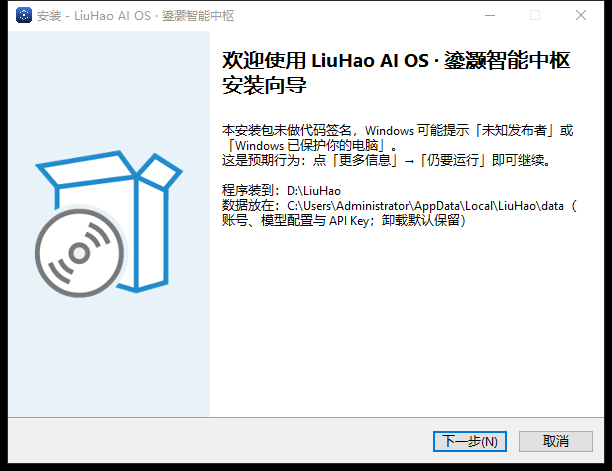 |
| 首屏之后先来一个 6 条长文“信息页”，读完才到下一步；对新手是信息墙 | 🟡 | 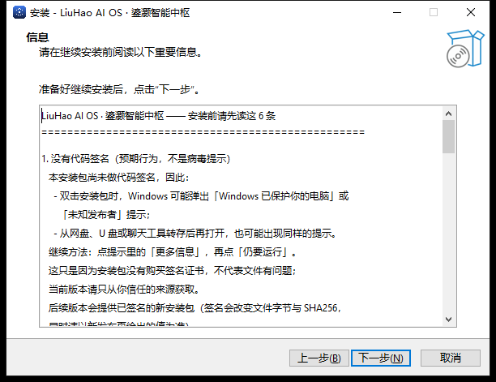 |
| **本机已有旧安装时，向导直接跳过“安装位置”页**，用户无法改路径；`/DIR` 也会被忽略（源码 `HasPrevInstall`/`UsePreviousAppDir`） | 🟡（升级路径） | 页面顺序：信息页 → 附加任务页，无目录页（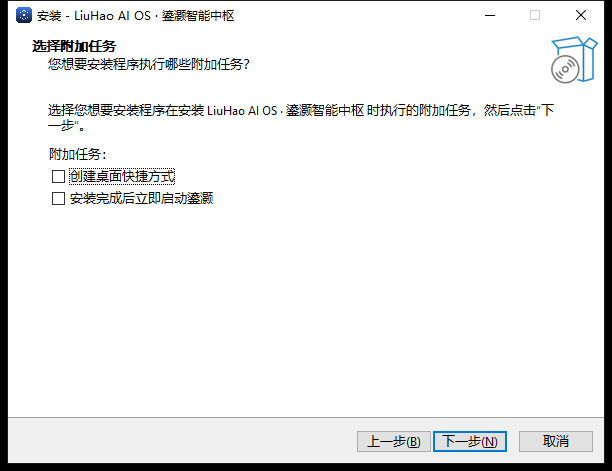） |
| “准备安装”页**没有任何摘要**：不显示程序目录、数据目录、附加任务，点“安装”前无法二次确认 | 🟡 | 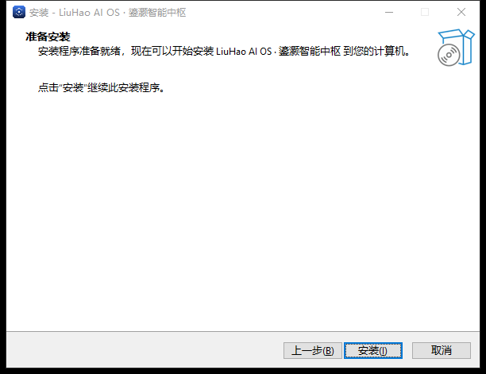 |
| 取消时有明确二次确认 | 🟢 | 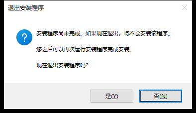 |

关键原文（首屏）：

> 本安装包未做代码签名，Windows 可能提示「未知发布者」或「Windows 已保护你的电脑」。这是预期行为：点「更多信息」→「仍要运行」即可继续。
>
> 程序装到：D:\LiuHao
> 数据放在：C:\Users\Administrator\AppData\Local\LiuHao\data（账号、模型配置与 API Key；卸载默认保留）

关键原文（准备安装页，全文只有两句）：

> 安装程序准备就绪，现在可以开始安装。点击「安装」继续此安装程序。

> 说明：干净机器首次安装时 Inno 会显示目录页；本机因已有安装被跳过。该项需在干净机器上复测，不能据此断言首装路径不可选。

---

### 第 2 步：装完第一次打开

| 观察 | 严重度 | 证据 |
|---|---|---|
| 首次启动是 3 步 GUI 向导（数据目录 → 管理员账号 → 模型可跳过），不是命令行问答 | 🟢 | 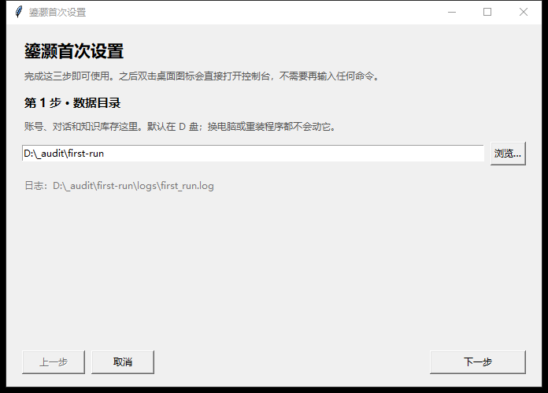 |
| 密码规则写在字段下方：至少 8 位且同时含字母和数字 | 🟢 | 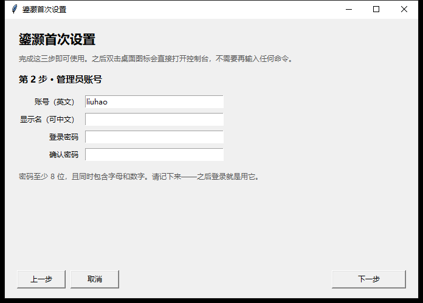 |
| 校验错误显示在窗口左下角，离输入框很远；且“确认密码不一致”未单独验证 | 🟡 | 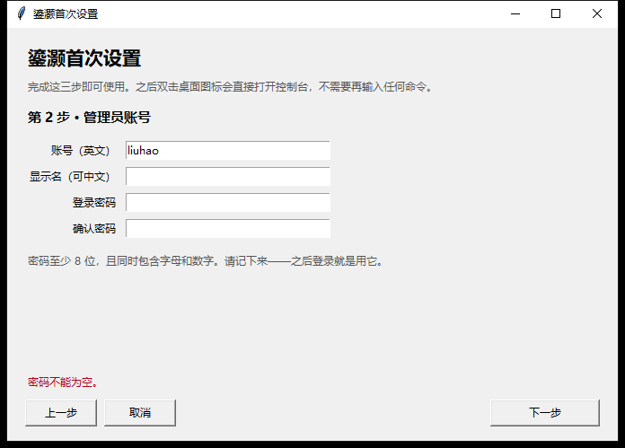 / 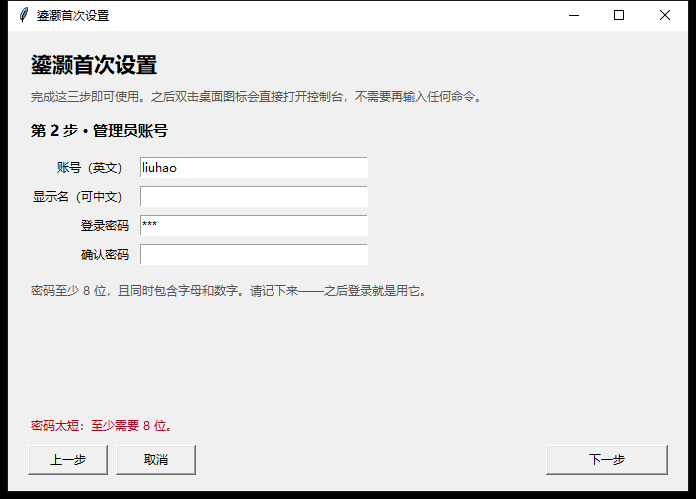 |
| 启动成功的黑窗把地址、日志、健康检查、关闭后果都说清楚了 | 🟢 | 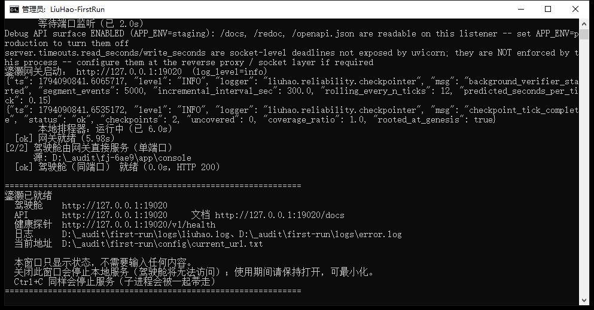 |
| 登录页黄条解释“黑窗是本地服务，请保持打开” | 🟢 | 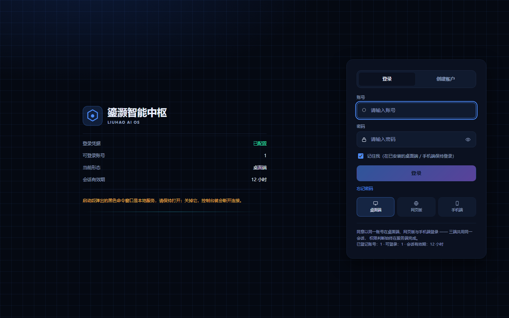 |
| 登录页左侧是开发信息（构建版本、Token 类型、httpOnly Cookie、会话凭据），对新手是噪音 | 🟡 | 同上 |
| 失败路径：等待 31.5 秒后打印 `[FAIL]`、日志与诊断包路径，可读 | 🟢（失败处理本身） | 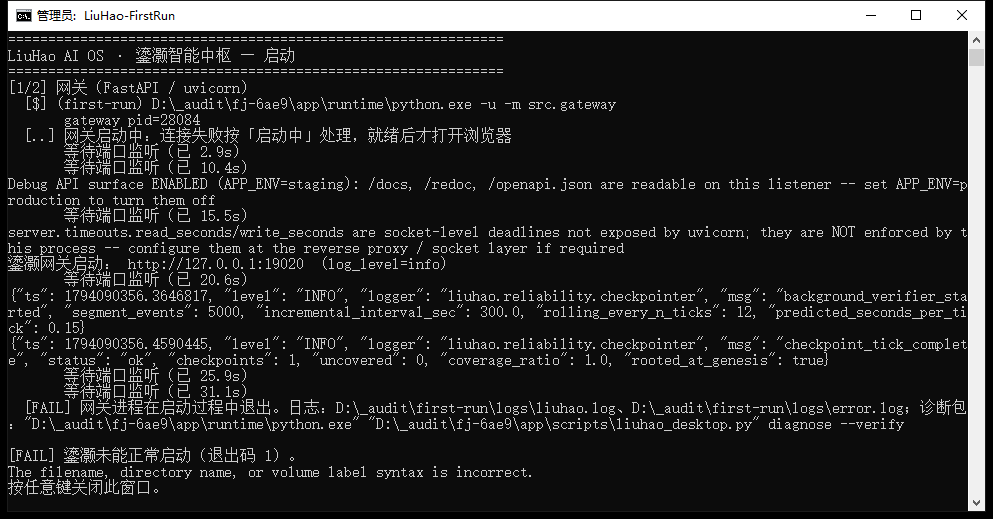 |

关键原文（成功）：

> 鎏灏已就绪 / 驾驶舱 http://127.0.0.1:19020 / 健康探针 http://127.0.0.1:19020/v1/health
> 本窗口只显示状态，不需要输入任何内容。关闭此窗口会停止本地服务（驾驶舱将无法访问）；使用期间请保持打开，可最小化。

关键原文（失败）：

> `[FAIL] 网关进程在启动过程中退出。日志: ... 诊断包: ...`
> `[FAIL] 鎏灏未能正常启动（退出码 1）。`

> ⚫ 本次截到的失败（`The filename, directory name, or volume label syntax is incorrect.`）来自隔离副本里自建 `data-dir.txt` 带了 BOM，属于走查环境自伤，**不计为产品缺陷**；仅保留作为“失败时用户能看到什么”的证据。修掉 marker 后第二次启动即健康（health=200）。

---

### 第 3 步：注册 / 登录

| 观察 | 严重度 | 证据 |
|---|---|---|
| 字段说明清楚：账号“字母或数字，登录时使用”；密码“至少 8 位，建议 10 位以上” | 🟢 | 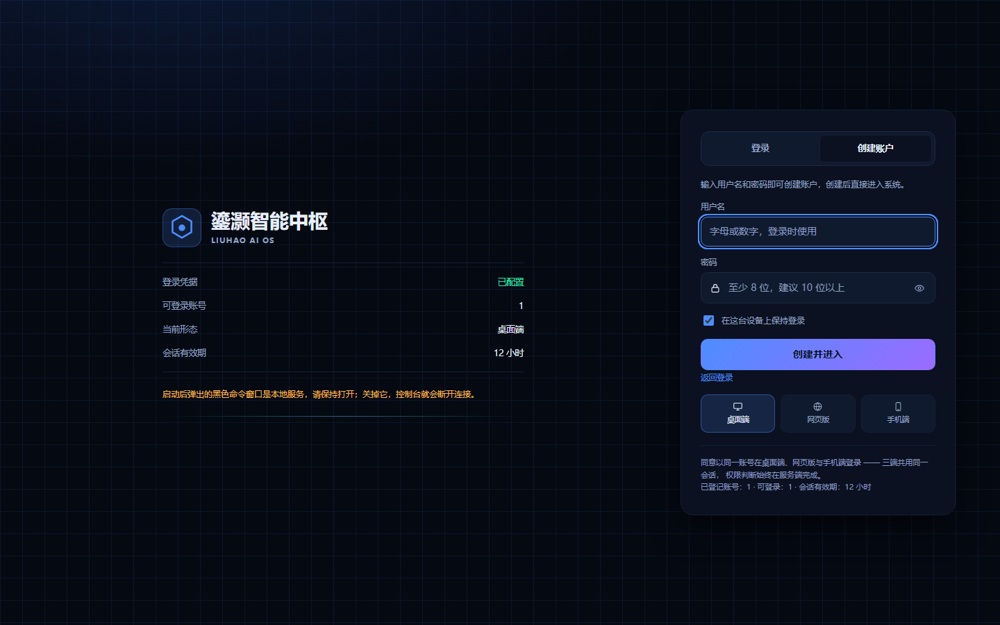 |
| 故意输错密码提示“账号或密码不正确 + 追踪 ID”，能看懂 | 🟢 | 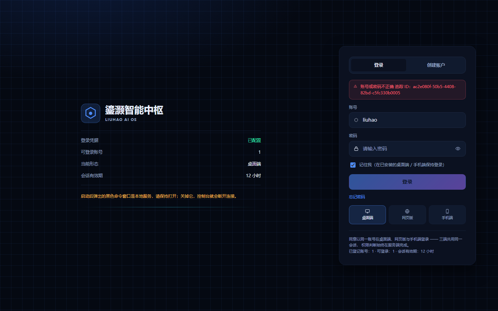 |
| 故意输错账号格式（中文账号）得到**同一句话**，不指出是格式问题；“追踪 ID”是开发术语 | 🟡 |  |
| **6 位密码提交后，界面给的是通用失败**：“操作没有完成，请稍后重试…导出诊断包…追踪 ID”，而不是“密码至少 8 位” | 🔴 | 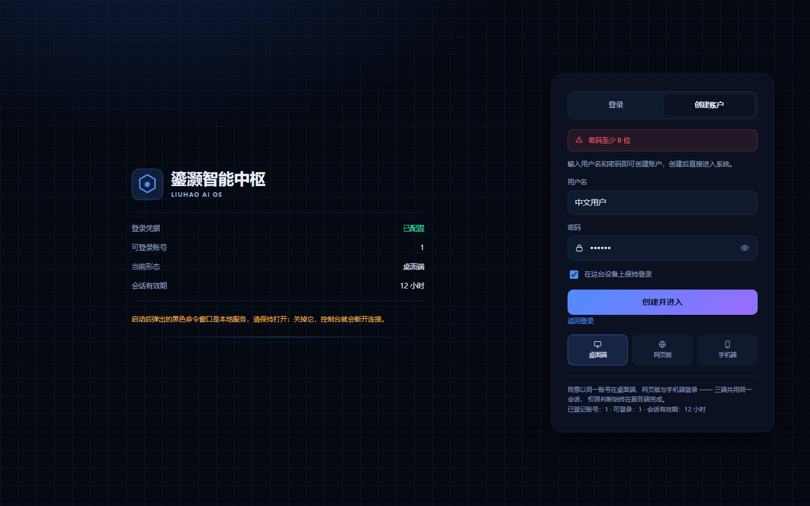 |
| 策略不一致：向导要求“字母+数字”，而创建账户接口实测接受**全数字 8 位**与**中文 principal** | 🔴 | 接口实测（`/v1/accounts/self-register`）：`12345678` → 200；`中文用户` → 200 |
| 合法注册可成功并返回“账号已创建并自动登录；当前使用的是最小权限…” | 🟢（服务端） | 同上（接口 200） |
| UI 端合法注册的成功路径未验证：首次 422 后重填未再发出请求，界面停在上一条通用错误 | ⚫ | 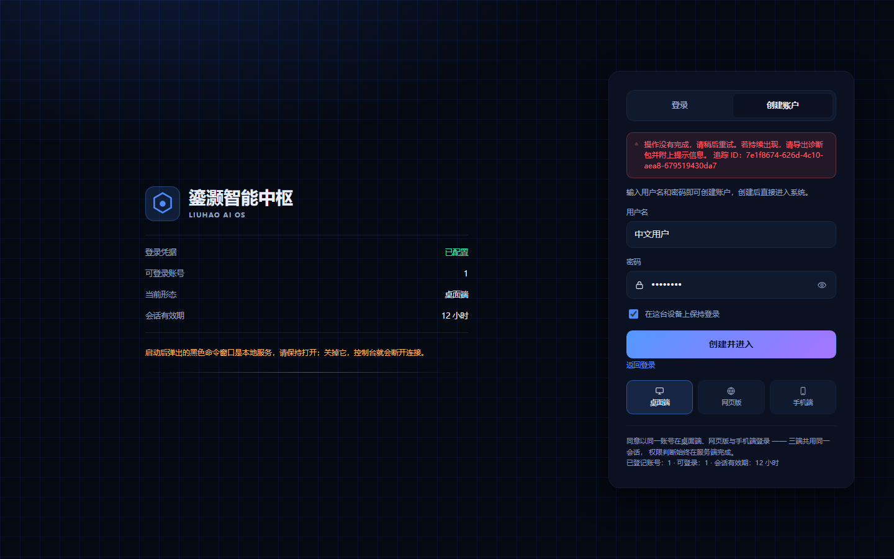 |

关键原文（6 位密码）：

> 操作没有完成，请稍后重试。若持续出现，请导出诊断包并附上提示信息。 追踪 ID：……

---

### 第 4 步：不看文档，3 步内找到“加模型 / 填 Key”

| 观察 | 严重度 | 证据 |
|---|---|---|
| 总览首屏顶部就有新手三步卡，第①条就是“配置模型”，点一次直达系统设置的模型管理区，第二次点击到表单 | 🟢（2–3 步可达） | 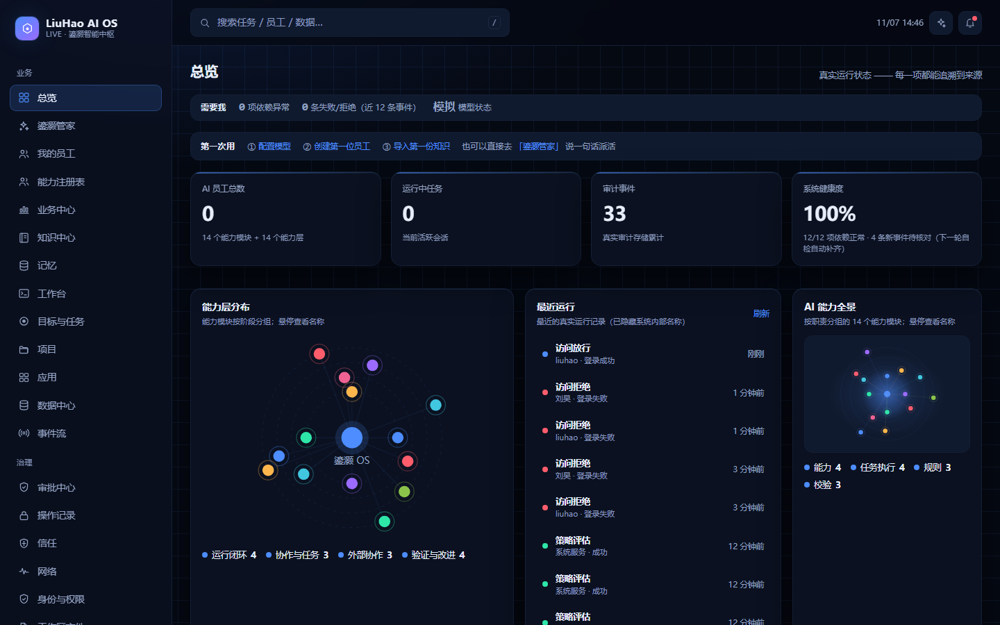 / 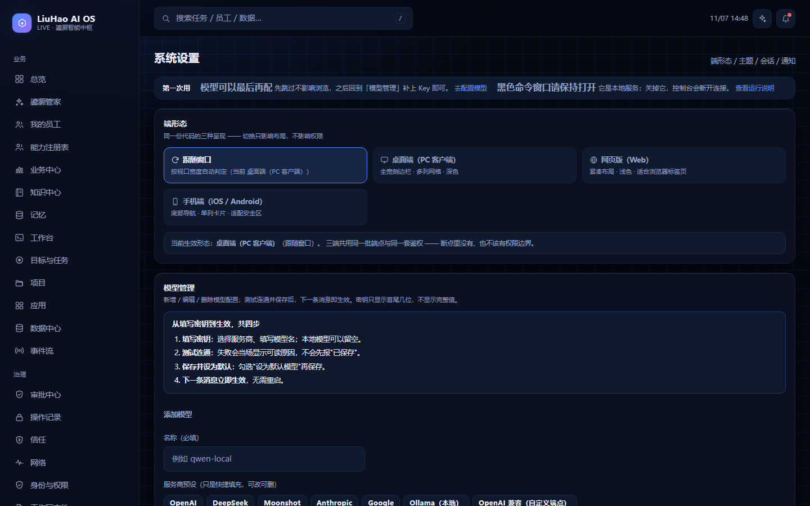 / 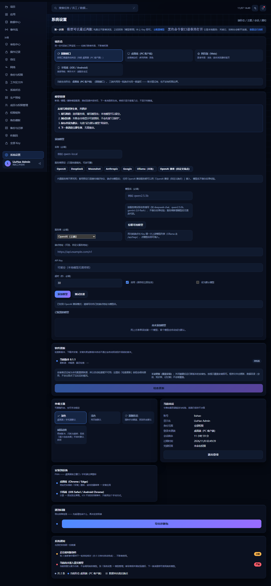 |
| 侧栏 20+ 项、分 5 组，还出现“全部 Key”“身份与权限”等术语，新手分辨成本高 | 🟡 | 同上 |
| 系统设置是超长单页，模型区需要滚动才能看到，缺少页内锚点 | 🟡 |  |

关键原文（新手卡）：

> 第一次用　① 配置模型　② 创建第一位员工　③ 导入第一份知识
> 也可以直接去「鎏灏管家」说一句话派活

---

### 第 5 步：填 Key（填错 / 带空格 / Key 失效）

| 观察 | 严重度 | 证据 |
|---|---|---|
| 粘贴带前后空格的 Key 被**原样入库**，请求头非法；日志原文 `Illegal header value b'Bearer   sk-***REDACTED***  '` | 🔴 | 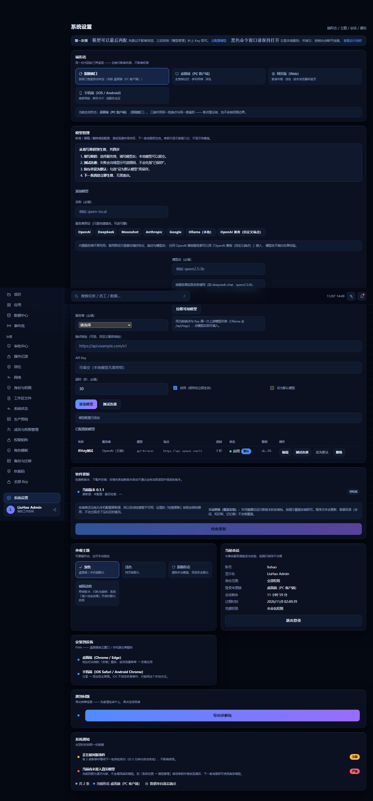；日志摘录第 [2] 条 |
| 表单默认勾选“设为默认模型”；第一个模型即使没测过也自动变“默认”（卡片出现“启用 / 默认”徽标） | 🔴 |  |
| 测试失败后仍可“设为默认”，并提示“已把「本机Ollama」设为默认模型” | 🔴 | 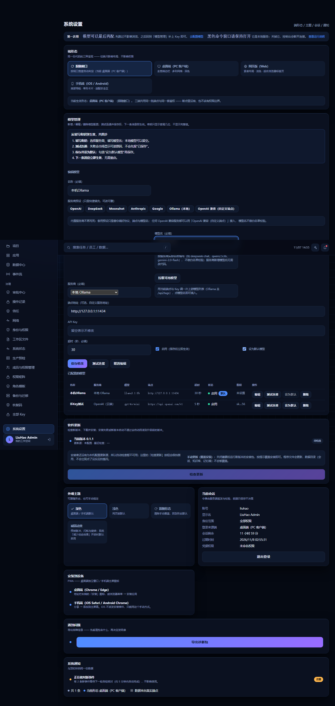 |
| 端点不通时提示准确 | 🟢 | “端点不可达。请检查端点地址、端口与网络连接是否正常。” |
| Key 失效（本地 401 mock）提示准确 | 🟢 | 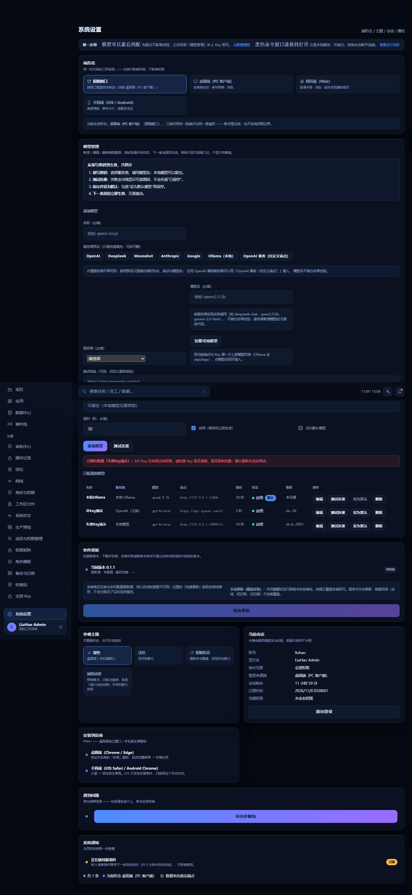： “API Key 无效或没有权限。请检查 Key 是否填错、是否复制完整；建议重新生成后再试。” |
| 模型名不存在时提示准确 | 🟢 | “模型名不存在或该端点不支持这个模型。请核对模型名称后重试。” |
| 自定义 OpenAI 兼容端点（127.0.0.1）被“服务商”列显示为“本地模型”，易误解 | 🟡 |  |
| Key 以 `sk-d…0001` 掩码展示 | 🟢 | 同上 |
| 连接成功的反馈带延迟，可信 | 🟢 | 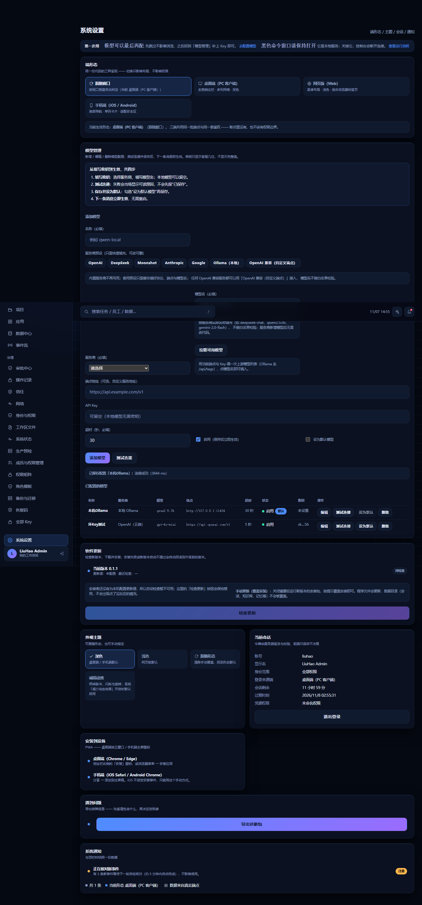： “已保存配置「本机Ollama」：连接成功（延迟 3844 毫秒）。” |

---

### 第 6 步：发出第一条消息

| 观察 | 严重度 | 证据 |
|---|---|---|
| 发送后按钮变“生成中...”，有等待反馈 | 🟢 | 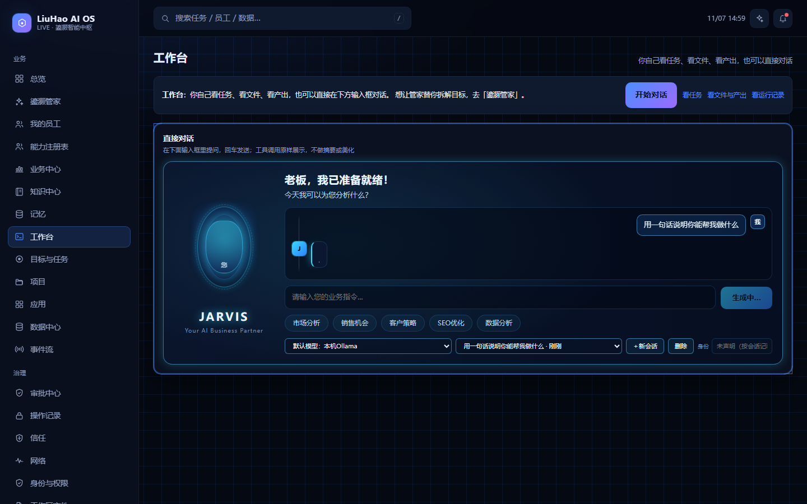 |
| **第一次生成在 30 秒读超时处失败**（唯一模型是本机 Ollama，测试已通过） | 🔴 | 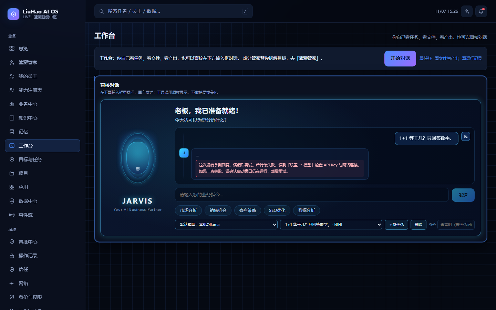；日志：`Read timed out. (read timeout=30.0)` |
| 失败文案**归因错误**：只说检查 API Key 与网络，不提“超时/首次加载/实际模型名” | 🔴 | 原文见下 |
| 多模型时，聊天忽略“设为默认”的 Ollama，选了坏 Key 的 gpt-4o-mini，且未使用 ollama fallback | 🔴 | 日志摘录第 [1] 条：`model=gpt-4o-mini ... fallbacks=0fa7a664c615` |
| 失败气泡是一段低对比度灰字，前面还留了一个“…”空气泡，像界面坏了 | 🟡 |  |
| **重试一次即成功**（模型已预热，约 36 秒，回复“2”） | 🟢 |  |
| 品牌/语气不一致：页面叫 JARVIS / Your AI Business Partner，称呼“老板”，侧栏叫「鎏灏管家」 | 🟡 |  |

失败原文：

> 这次没有拿到回复，请稍后再试。若持续失败，请到「设置 → 模型」检查 API Key 与网络连接。
> 如果一直失败，请确认启动窗口仍在运行，然后重试。

---

### 第 7 步：让「鎏灏管家」安排一个员工干活

| 观察 | 严重度 | 证据 |
|---|---|---|
| 提交后立刻给出预期（“约 1–2 分钟”），有进行中卡片 | 🟢 | 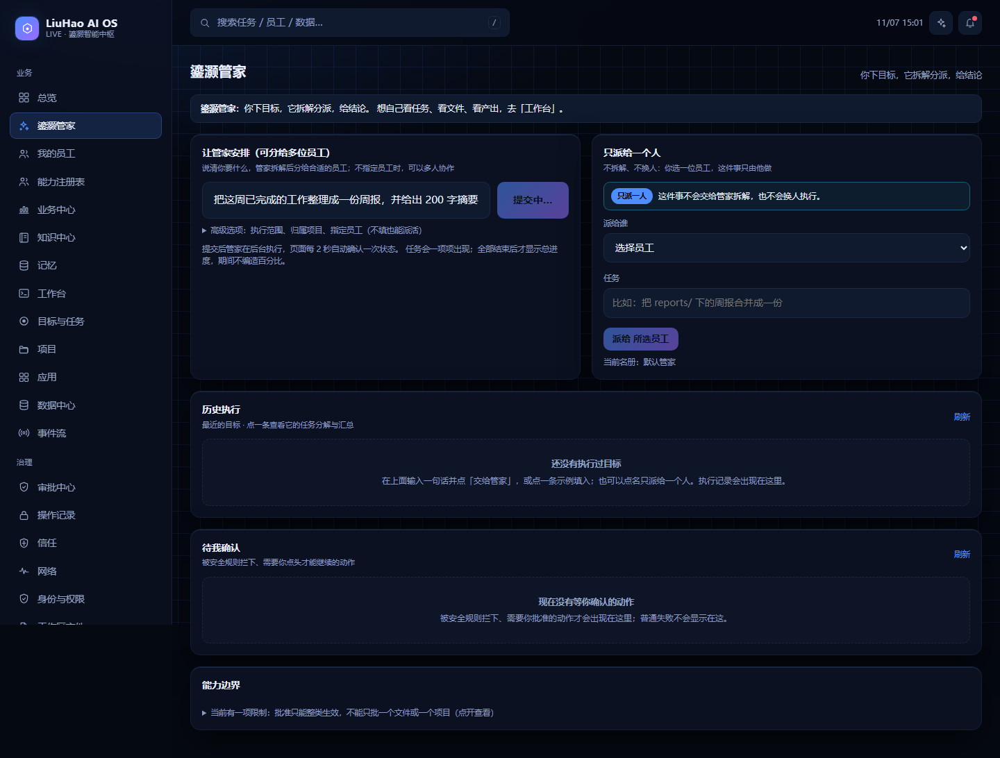 |
| 27 秒完成，总进度 100%，1 个任务；结果出现在「管家汇总」+「任务分解」，员工统计在「AI员工」卡 | 🟢 | 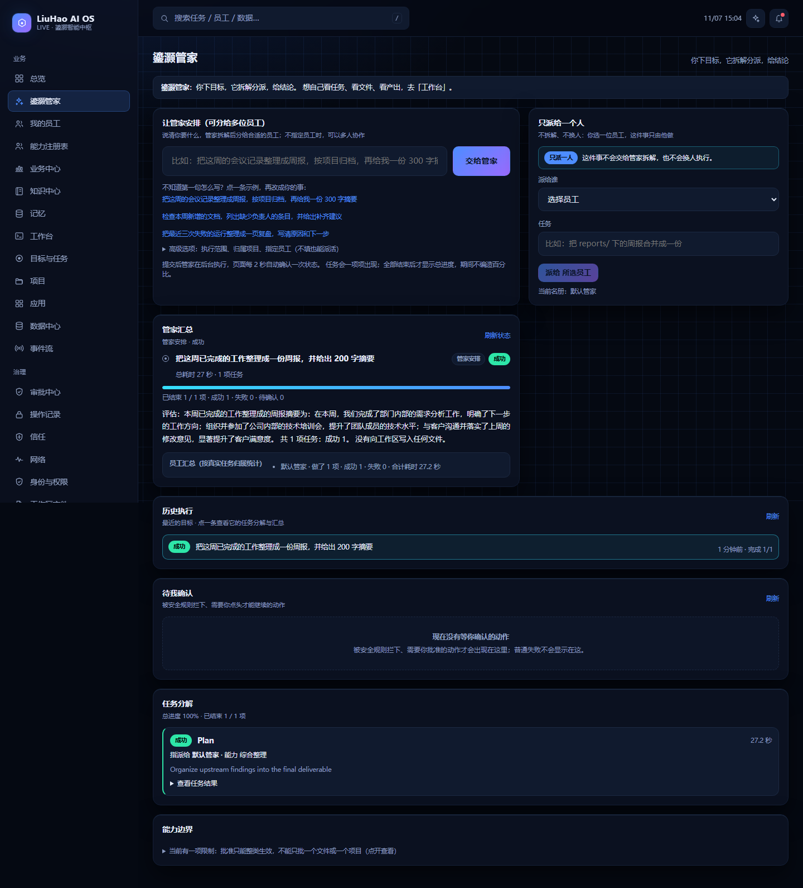 |
| **结果是杜撰的“本周周报 + 假引用”**（`https://example1.com`、`example2.com`、`example3`），且未写任何文件 | 🔴 |  / 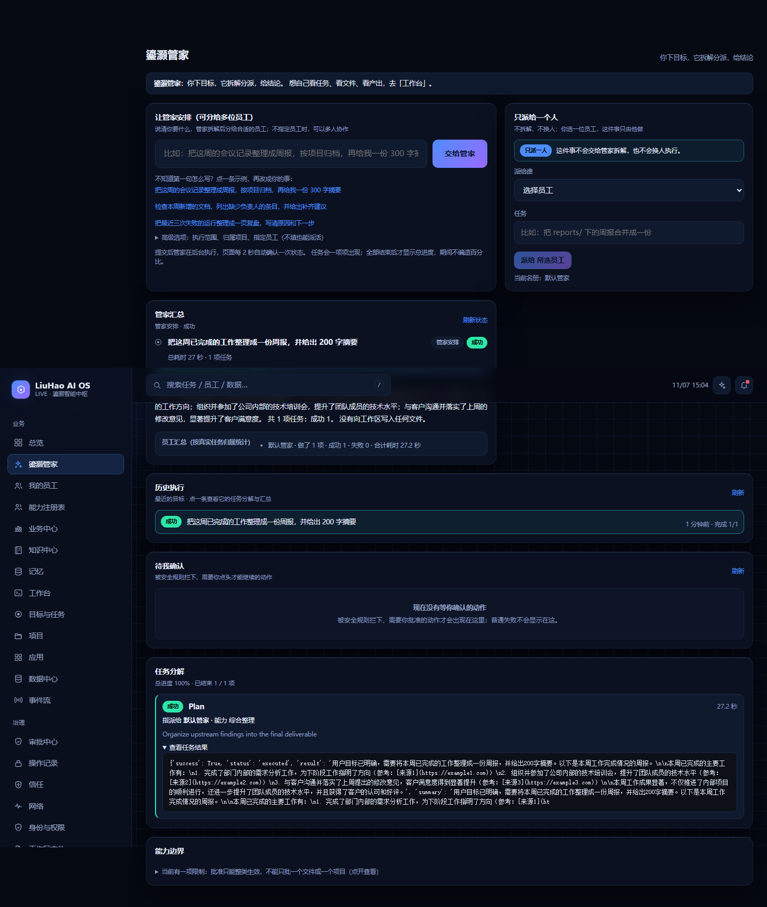 |
| 任务卡显示英文内部描述（`Plan` / `Organize upstream findings into the final deliverable`） | 🟡 |  |
| “只派给一个人”下拉的选项为空（只有占位“选择员工”）；我的员工只有系统默认管家 | 🟡 | 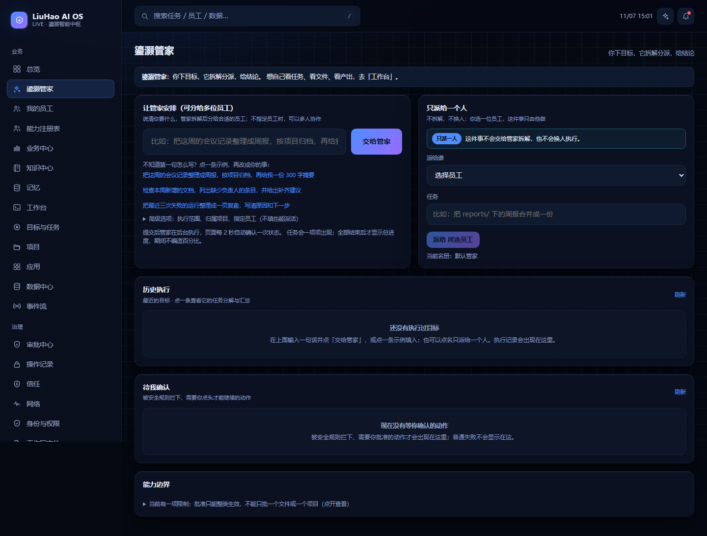 / 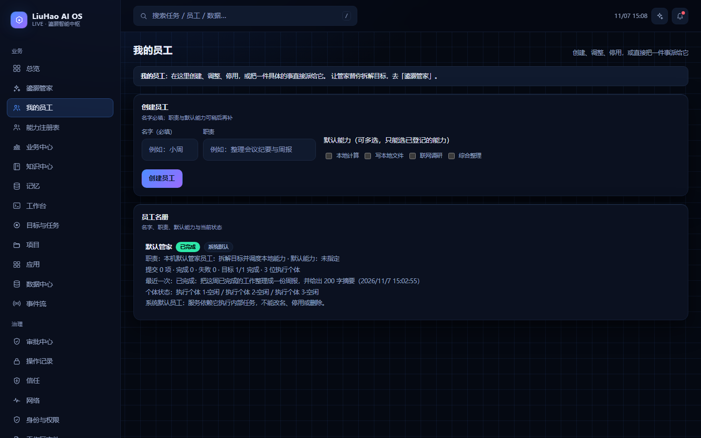 |
| LLM 拆解失败后静默降级为关键词拆解，用户无感知 | 🟡 | 日志：`LLM decomposition unavailable (...) falling back to keyword planner` |
| “没有向工作区写入任何文件”这句虽然诚实，但对“干完一件事”没有交付物 | 🟡 |  |

---

## 四、最少改哪几处，能让新手一次走通

### P0：不改就走不通

1. **给生成留足首次加载时间，并把错误说对**
   - 位置：`src/ai/providers.py`（`chat_stream` 读超时）与聊天失败文案。
   - 改法：读/首字超时 30s → 至少 120s；首次调用先预热或失败自动重试一次；超时文案明确写“本地模型首次加载较慢（约 1 分钟），请重试”，不要指向 Key/网络。
2. **聊天必须用“用户设为默认”的模型，并真正使用 fallback**
   - 位置：`src/ai/model_router.py` 的 `provider_for_task`（现在先按任务路由，默认模型优先级更低）。
   - 改法：`task=chat` 时 `default_model_id` 最高优先；首选失败按 `fallbacks` 依次尝试；错误文案带“实际模型名 + 原因分类（超时/Key/网络/模型不存在）”。
3. **Key 入库/调用前 trim，并保住 401 分类**
   - 位置：`src/ai/model_config.py`（`_encrypt_secret(model_id, str(payload["api_key"]))` 无 strip）。
   - 改法：`str(...).strip()`；空白字符直接判非法；确保 401 继续映射为“API Key 无效”。

### P1：能走通，但会被误导或返工

4. **未测试通过不得默认**：`create` 里“第一个模型自动 `is_default`”要改成只在测试通过后；最近一次失败后禁用“设为默认”，卡片持久显示“最近一次测试：失败（原因）/ 时间”。
5. **注册/登录的 422 变成字段级提示**：6 位密码就显示“密码至少 8 位”，不要“操作没有完成…导出诊断包”；同时统一向导与注册页的密码策略（要么都要求字母+数字，要么都只要求长度）。
6. **安装“准备”页固定显示摘要**：程序目录 / 数据目录 / 附加任务；升级安装时至少给一个只读确认块，别让用户盲点“安装”。
7. **管家产出不许编**：无来源就不写引用；明确标注“仅建议、未写入文件”；要写文件就落盘并在「任务结果」给出路径与预览。
8. **重建 console 包并统一品牌**：当前安装包内仍是 JARVIS 旧 UI（`JARVIS / 老板 / Your AI Business Partner`），与仓库源码的「鎏灏管家」不一致；发布前必须把前端产物重新打包并校验。

如果只能改一处：**改 P0-1（超时+预热+正确文案）**，新手就能“第一次发消息成功”。
如果改两处：再加 **P0-2（默认模型优先）**，避免多模型时被坏模型劫持。

---

## 五、证据清单

| 文件 | 内容 |
|---|---|
| `installer-02-start.png` | 安装首屏：签名提示、程序/数据默认路径 |
| `installer-08-dir.png` | “请在继续安装前阅读以下重要信息”（6 条） |
| `installer-09-dir.png` | 附加任务页（目录页被跳过） |
| `installer-10-ready.png` | 准备安装页（无摘要） |
| `installer-11-cancel.png` | 退出安装确认 |
| `firstrun-gui-01/02/03/04/05/06/08.png` | 首启向导 3 步、密码规则与错误、模型可跳过、完成态、启动成功控制台 |
| `firstrun-gui-07-console.png` | 启动失败时的 `[FAIL]` 与日志路径（环境自伤，仅作展示） |
| `web-01-login.png` | 登录首屏（含黑窗说明与开发信息面板） |
| `web-03-wrongpw.png` / `web-04-badformat.png` | 错密码 / 错账号格式提示 |
| `web-22/23/24-register*.png` | 创建账户字段说明、6 位密码通用失败、重填后状态 |
| `web-06-dashboard.png` | 总览/新手三步卡/侧栏 |
| `web-08-model-form.png` / `web-10-model-added.png` | 模型表单、首个模型自动“默认” |
| `web-12b-ollama-edit.png` | 失败后仍可设默认 |
| `web-13b-ollama-test.png` | 测试成功（3844 ms） |
| `web-19b-key-401.png` | Key 失效（401）提示 |
| `web-17-chat-sending.png` / `web-26-chat-fail-only-ollama.png` / `web-27-chat-retry-ok.png` | 生成中、首条失败、重试成功 |
| `web-20-dashboard-after-model.png` | 配好模型后的总览（真实/模型状态） |
| `web-21-employees.png` | 我的员工（仅默认管家） |
| `butler-02-submitted.png` / `butler-06-detail.png` / `butler-07-task-result.png` | 管家提交、完成详情、任务结果（含假引用） |
| `evidence-gateway-log.txt` | 路由、非法 Header、探测分类、超时、拆解降级的原始日志摘录 |
