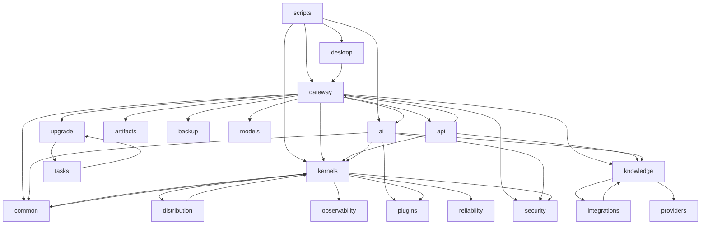

# 架构域只读深度体检报告（findings-architecture）

- 审计对象：`d:\LiuHao-AI-OS`
- 审计时间：2026-11-08
- 审计范围：`src/**`、`apps/**`、`scripts/**`（Python 739 个文件全部解析成功；前端 `apps/console` 抽查）
- 审计方式：AST 静态分析 + Tarjan SCC 环检测 + 仓库自带守卫脚本 + 真实 import 探针 + 定点复现
- 边界声明：**未改任何代码、未 commit、未 git stash**；未触碰 `src/desktop/**`、`packaging/**`、`installer/**`、`src/ai/providers.py`、`src/security/**`、`src/ai/model_config.py`、`src/knowledge/**`、`src/gateway/rate_limiter.py`、`src/gateway/health.py`、`src/gateway/policy.py`、`apps/console/console/src/components/ChatPanel.tsx`。
- 证据强度说明：本报告以静态分析 + 可执行探针为准；**没有**跑全量测试、没有采集新的运行期覆盖率（`.coverage` 未用于本报告）。凡标注“静态判断”的条目均未做运行期证明。
- 快照说明：工作树存在其他工作流的大量未提交改动；**全部行号对应当前工作树 2026-11-08 快照**，他人提交后可能漂移。

## 审计方法与原始数据

| 项目 | 数值/命令 | 说明 |
|---|---|---|
| Python 文件 | 739 | `src`/`apps`/`scripts`，全部 AST 解析成功（0 语法错误） |
| 函数定义 | 12068 | 用于复杂度、长度、嵌套统计 |
| 包级强连通分量（SCC） | 4 | `src.common↔src.kernels`、`src.tasks↔src.upgrade`、`src.api↔src.gateway`、`scripts.first_run_gui↔scripts.launch_installed` |
| 模块级强连通分量（SCC） | 2 | `src.distribution.coordination↔src.kernels.execution.fence`、`scripts.first_run_gui↔scripts.launch_installed` |
| 孤儿审计 | `python scripts/verify_no_undocumented_orphans.py` | 5 个零引用、40 个仅测试可达、5 条登记已过期 |
| 零调用函数审计 | `python scripts/verify_zero_caller_decision_functions.py --sample 0` | 1102 个决策型公开函数，211 个零引用，其中 76 个无假阳性信号（脚本自报误报率 64%，只报告不 gate） |
| 真实 import 探针 | `python -c "importlib.import_module(...)"`（数据目录重定向到临时目录） | 6 个环参与模块全部 `IMPORT OK`，说明当前是**惰性/聚合环**，不是 import 崩溃 |

### 模块依赖图（包级，只画主要产品链路）

> 注：`src.common -> src.kernels` 只由 `src/common/integrity_key.py:255` 的函数内 import 产生；`src.api -> src.gateway` 只由 `src/api/routes/knowledge.py:131/174/175` 的函数内 import 产生；两条都为惰性，故模块级 SCC 未报环，但包级方向已成环。

### 循环依赖最小环（包级）

| 最小环 | 正向证据 | 反向证据 | 环类型 |
|---|---|---|---|
| `src.common → src.kernels → src.common` | `src/common/integrity_key.py:255` `from src.kernels.identity._persistence import FIELD_INTEGRITY, compute_row_tag` | `src/kernels/identity/_persistence.py:51` `from src.common.atomic_write import ...` | 聚合环（正向惰性） |
| `src.tasks → src.upgrade → src.tasks` | `src/tasks/local_handlers.py:29` `from src.upgrade.update_check import ...` | `src/upgrade/update_check.py:33-34` `from src.tasks.local_scheduler ...`、`from src.tasks.reminder_notify ...` | 聚合环（两侧顶层 import，但指向不同子模块，当前不炸） |
| `src.api → src.gateway → src.api` | `src/api/routes/knowledge.py:131/174/175` `from src.gateway.account_context/policy import ...` | `src/gateway/main.py:2307` `from src.api.routes.knowledge import ...` | 聚合环（两侧均在函数内） |
| `scripts.first_run_gui → scripts.launch_installed → scripts.first_run_gui` | `scripts/first_run_gui.py:511` `from scripts import launch_installed as installed` | `scripts/launch_installed.py:989` `import scripts.first_run_gui as gui` | 模块级真环（两侧惰性） |

### 模块级真环

| 最小环 | 证据 |
|---|---|
| `src.distribution.coordination → src.kernels.execution.fence → src.distribution.coordination` | 正向 `src/distribution/coordination.py:59` 顶层 `from src.kernels.execution.fence import (...)`；反向 `src/kernels/execution/fence.py:1177/1214` 函数内 `from src.distribution import coordination as _coord` |

---

## 分级统计

| 等级 | 数量 |
|---|---|
| P0 | 0 |
| P1 | 2 |
| P2 | 11 |
| P3 | 8 |
| P4 | 4 |
| 合计 | 25 |

---

## ARCH-01 API 层与网关层双向依赖，授权原语分裂

- 编号：ARCH-01
- 模块：`src/api/routes/knowledge` ↔ `src/gateway`
- 文件:行号：`src/api/routes/knowledge.py:131`、`src/api/routes/knowledge.py:174`、`src/api/routes/knowledge.py:175`；`src/gateway/main.py:2307`
- 表现：网关在 `get_app()` 内挂载 `src.api.routes.knowledge` 的 router；该 router 又在函数内反向 import `src.gateway.account_context`（`deny`、`require_account_principal`）与 `src.gateway.policy`。包级方向 `src.api → src.gateway` 与 `src.gateway → src.api` 同时成立。
- 是否复现：已复现（静态 + 真实 import）。AST 扫描输出包级环 `src.api -> src.gateway -> src.api`；`python -c "importlib.import_module('src.api.routes.knowledge')"` 返回 `IMPORT OK`，证明当前靠函数内 import 规避。
- 根因：账号/策略授权实现落在网关包内，但被 API 路由直接消费；网关又需要挂载 API 路由，于是形成“上层依赖下层、下层又依赖上层”的双向关系。没有独立的授权领域层。
- 影响面：网关与 API 路由无法独立拆包、独立测试；知识库路由的鉴权路径与网关其他路由的鉴权路径来自两个包，策略变更可能出现“只改一侧”。
- 安全或数据风险：中高。授权判定分散在 `gateway/account_context`、`gateway/policy`、`api/routes/knowledge` 三处，越权/漏判的回归面变大；新增知识库端点容易漏挂 `_require_human` 依赖。
- 修复方案：抽取 `src/authz`（或 `src/security/authorization`）承载 `AccountContext`、`deny`、`require_*`、策略求值；`api/routes/knowledge` 只依赖该层；`gateway` 也依赖该层。注意 `src/gateway/policy.py` 当前在他人工作树白名单内，迁移必须与对应工作流串行，不能直接改。
- 需要改的文件：新增 `src/authz/**`（或复用 `src/security`）；`src/gateway/account_context.py`；`src/gateway/policy.py`（需协调）；`src/api/routes/knowledge.py`；`src/gateway/main.py`。
- 验证方法：`scripts/verify_openapi_contract.py` 比对路由表；新增静态守卫：禁止 `src/api/**` 出现 `from src.gateway`；跑 `tests/test_identity_*`、知识库授权测试。
- 等级：P1
- 状态：OPEN

## ARCH-02 网关层直连 SQLite 并自建 schema，跨层读取内核数据库

- 编号：ARCH-02
- 模块：`src/gateway`（account_memory / account_usage / account_backup）
- 文件:行号：
  - `src/gateway/account_memory.py:37/46/52`（`CREATE TABLE account_memory_entries/custody/migrations`）、`:109` 直连；`:856/890` 直接 `sqlite3.connect(kernel_path)` 读内核库，`:910` 直接 `sqlite3.connect(profile_path)` 读画像库
  - `src/gateway/account_usage.py:28`（`CREATE TABLE account_usage_events`）、`:101` 直连
  - `src/gateway/account_backup.py:86/88/410/412/419/1010/1240/1302/1362`，以及 `:1014/1020/1243/1306/1366/1372/1377/1381/1385` 共 10 处 DDL
- 表现：HTTP 网关层自行定义表结构与连接管理；备份模块直接打开内核 shard 的 SQLite 文件做读写式快照/校验；同一进程里出现多套连接打开逻辑（timeout=10 重复 10+ 次）。
- 是否复现：已复现（静态）。AST 扫描 + 定点 grep：`src/gateway` 命中 14 条 `CREATE TABLE IF NOT EXISTS`、13 条真实 `sqlite3.connect` 调用（另有 2 条注释提及）。审计端点 `src/gateway/audit.py:190` 明确注释“用 store._read_only 而不是自己 connect”，说明团队已意识到该红线，但其余模块未遵守。
- 根因：缺少存储/仓储层；账号记忆、用量、备份各自把持久化实现写进路由模块。
- 影响面：schema 所有权分裂（网关 vs 内核 vs 备份）；内核字段完整性约束（`FIELD_INTEGRITY`/row tag）在直连读取路径上被绕过；备份与迁移顺序难以推理；单元测试必须造真实 SQLite 文件。
- 安全或数据风险：中高。直连内核库绕过内核的完整性校验与审计写入；若内核 schema/加密方式变更，网关不会在编译期报错，而是运行期静默读错或读空。
- 修复方案：建立唯一仓储层（建议 `src/storage/repositories/` 或 `src/gateway/repositories/`），集中 schema、连接、迁移、完整性校验；网关只调用仓储接口；备份只调用 `backup_service` 导出的快照 API。
- 需要改的文件：`src/gateway/account_memory.py`、`account_usage.py`、`account_backup.py`、`account_context.py`；新增仓储模块。
- 验证方法：静态守卫“`src/gateway/**` 禁止 `sqlite3`/`CREATE TABLE`”；对 `account_memory`/`account_usage`/`account_backup` 做契约测试；`scripts/verify_persistence.py`、`scripts/verify_orm_vs_db.py`。
- 等级：P1
- 状态：OPEN

## ARCH-03 两套 token 估算，中文计费口径低估约 4 倍

- 编号：ARCH-03
- 模块：`src/ai/context_budget` vs `src/gateway/chat`
- 文件:行号：`src/ai/context_budget.py:102-118`；`src/gateway/chat.py:655-657`
- 表现：
  - `context_budget.estimate_tokens`：CJK 字符 1 字≈1 token，ASCII 4 字符≈1 token（用于上下文预算）。
  - `chat._estimate_tokens`：`max(1, len(text)//4)`，不区分 CJK（用于无 usage 时的账本估算，代码注释写明“账本里标记 estimated=1”）。
- 是否复现：已复现（真实运行）。`budget_est('你'*40) = 40`；同一文本按 chat 公式 `max(1, 40//4) = 10`。
- 根因：预算模块与计费/账本模块各写一套启发式，没有单一 token 估算出口。
- 影响面：中文会话的预算判定按 40 token 拒绝，而账本只记 10 token；用量统计、成本核算、限流阈值与实际语义不一致，且随中文占比线性放大。
- 安全或数据风险：数据完整性风险（账本低估），非安全漏洞；会误导成本报表与容量规划。
- 修复方案：统一到 `src/ai/context_budget.estimate_tokens`；`chat._estimate_tokens` 改为委托调用（保留 `estimated=1` 标记）；若担心预算“上界倾向”，在单一函数内参数化，不再复制公式。
- 需要改的文件：`src/gateway/chat.py`（仅该函数）；`src/ai/context_budget.py`（补单元测试，可选）。
- 验证方法：新增参数化测试：中文 40 字、英文 40 字符、混合文本，断言两处调用返回同值；扫描全仓禁止出现 `len(...)//4` 的 token 估算。
- 等级：P2
- 状态：OPEN

## ARCH-04 错误响应体 4 种形状，且统一错误目录是死代码

- 编号：ARCH-04
- 模块：`src/gateway` 错误处理 + `src/errors` + 根 `error_types.py`
- 文件:行号：
  - `src/gateway/main.py:2101/2111` → `{"detail": ...}`（框架默认形状，覆盖 detail）
  - `src/gateway/main.py:2124` → `{"detail": [public_validation_errors(...)]}`（422 列表）
  - `src/gateway/main.py:2171` → `{"error": "validation_error", "detail": ...}`
  - `src/gateway/main.py:2198/2220` → `{"error": "policy_approval_required"/"policy_denied", "detail": ...}`
  - `src/gateway/main.py:828` → `{"error": "origin_not_allowed", "detail": ...}`
  - `src/gateway/account_context.py:125-142` → 结构化 detail 摊平为 `{"code","message","detail"}`
  - `src/errors/__init__.py:9-19`、`src/errors/error_codes.py`（全仓生产代码零引用，仅 `__init__` 与 2 个测试 import）
  - 根 `error_types.py`：5 处生产 import（`src/providers/llm_base.py:13`、`src/knowledge/embedding.py:38`、`src/ai/providers.py:312/631`、`src/gateway/models.py:940`），另有 1 处注释引用 `src/upgrade/startup_probe.py:292`；均依赖仓库根隐式 import
- 表现：同一 API 面存在 `{detail}`、`{error,detail}`、`{code,message,detail}`、422 `{detail:[...]}` 四种错误体；同时存在三个错误抽象：`src/errors` 目录、根 `error_types.py`、网关内联 `deny`。
- 是否复现：已复现（静态 grep，行号与形状逐条命中）。`src/errors` 的生产引用数为 0（`grep -rn "from src.errors"` 仅命中自身 `__init__` 与测试）。
- 根因：错误目录/异常基类各自为政；网关为了驾驶舱可读性手工摊平 detail，没有统一错误中间件。
- 影响面：前端与外部调用方必须对 4 种形状做兼容；客户端错误码解析不稳定；新增端点容易发明第 5 种形状。
- 安全或数据风险：低到中。错误体里若混入内部 `str(exc)`，存在信息泄露面；形状不统一会增加客户端“把错误当成功”的误判概率。
- 修复方案：定义唯一错误信封（建议 `{code,message,detail,request_id}`）+ 唯一异常目录（保留 `src/errors/error_codes`，删除/迁移根 `error_types.py`）；在 FastAPI exception handler 统一渲染；422 也映射到同一信封。
- 需要改的文件：`src/errors/**`（转为唯一目录）、根 `error_types.py`（改为转导出或删除，需与 providers 工作流协调）、`src/gateway/main.py`、`src/gateway/account_context.py`、`src/gateway/observability.py`、`src/gateway/validation.py`。
- 验证方法：`scripts/verify_openapi_contract.py` + 新增错误体快照测试（400/401/403/404/409/422/500 全覆盖）；`scripts/verify_authorization_enumerable.py`。
- 等级：P2
- 状态：OPEN

## ARCH-05 业务层绕过 ConfigManager 直读 os.environ

- 编号：ARCH-05
- 模块：`src/gateway`、`src/ai`、`src/kernels`、`src/knowledge`、`src/tasks` 等
- 文件:行号：全仓 `os.environ/os.getenv` 命中 897 行（AST 统计）；其中 `src/gateway` 83、`src/ai` 60、`src/kernels` 47、`src/desktop` 38、`src/security` 29、`src/knowledge` 26、`src/tasks` 26、`src/upgrade` 14
- 表现：项目已有统一配置入口 `src/config_manager.py`（环境变量 > .env > configs > 默认值），但生产代码仅 4 处使用：`alembic/env.py:15`、`src/plugins/manager.py:31`、`src/gateway/main.py:2463`、`src/gateway/validation.py:134`。其余业务模块直接读环境变量。
- 是否复现：已复现（AST 统计 + grep 计数）。真实 import 探针不涉及此条；属于纯静态确认。
- 根因：ConfigManager 从未被立为唯一入口，历史代码先读 env 后补 config；没有 lint/守卫。
- 影响面：配置项来源不可枚举；默认值/优先级在多处重复；测试只能靠 monkeypatch env；`configs/` 文件对多数模块实际无效。
- 安全或数据风险：中。密钥/开关的读取路径无法集中审计；某模块读 `os.environ` 而另一模块读 `.env`，会出现“配置看起来生效其实没有”（`config_manager.py:16-18` 注释已记录同类隐患）。
- 修复方案：冻结 `ConfigManager` 的读取 API（`get_config().get(key, default)`），新代码禁止直读 env；存量按包分批迁移（先 gateway/ai 两包）；加静态守卫白名单。
- 需要改的文件：`src/config_manager.py`（扩展 schema 与默认值）；`src/gateway/**`、`src/ai/**`、`src/knowledge/**`、`src/tasks/**` 的读取点；新增 `scripts/verify_config_single_source.py`。
- 验证方法：AST 守卫扫描 `src/**`（排除 `logging_config`/`bootstrap`/`config_manager`）；配置优先级单测；启动 smoke。
- 等级：P2
- 状态：OPEN

## ARCH-06 85 个未挂载 API 端点 + 进程内字典伪持久化（重复实现）

- 编号：ARCH-06
- 模块：`src/api/{admin_api,agents_api,cost_api,knowledge_api,memory_api,plugins_api,tasks_api,health_api}`
- 文件:行号：
  - 端点数量：`admin_api.py` 15、`agents_api.py` 10、`cost_api.py` 10、`knowledge_api.py` 13、`memory_api.py` 9、`plugins_api.py` 11、`tasks_api.py` 10、`health_api.py` 7（共 85）
  - 唯一挂载点：`tests/test_api_extended.py:38-49`（测试自建 FastAPI app）
  - 进程内存储：`src/api/tasks_api.py:119` `_tasks: Dict[str, Dict[str, Any]] = {}`；`src/api/memory_api.py:119` `_memories = {}`；`src/api/knowledge_api.py:111-113` `_knowledge_bases/_documents/_collections = {}`
- 表现：网关 `src/gateway/main.py` 只挂载 `src/api/routes/knowledge` 及其 legacy router（`:2307/2311/2312`），上述 8 个模块从未被生产 app include；它们用模块级 dict 模拟数据库，进程重启即丢数据。
- 是否复现：已复现（静态 + 仓库孤儿脚本）。`verify_no_undocumented_orphans.py` 将 8 个模块列为 “test-only reachable”；`grep include_router` 在生产入口中无这些模块。
- 根因：早期 API 扩展层与网关数据层并行演进；扩展层未完成持久化就被网关的 `data_*` 路由取代，但模块被保留以支撑测试。
- 影响面：约 85 个接口是“看似存在、实际不可达”的空壳；与实际网关能力（accounts/memory/chat/knowledge/plugins/tasks）形成重复实现；测试覆盖的是影子实现，不能证明生产 API。
- 安全或数据风险：中。若未来有人直接 `include_router(admin_api.router)`，会得到无鉴权、无持久化、字段形状不同的管理面；`tasks_api`/`memory_api` 重启丢数据。
- 修复方案：二选一——(a) 删除这 8 个模块并把测试改为直接测网关真实路由；(b) 若要保留，必须接入统一仓储层与鉴权，纳入正式 app 并补迁移。禁止继续“测试专用 + 内存态”。
- 需要改的文件：`src/api/admin_api.py`、`agents_api.py`、`cost_api.py`、`knowledge_api.py`、`memory_api.py`、`plugins_api.py`、`tasks_api.py`、`health_api.py`、`tests/test_api_extended.py`、`orphan-registry.yaml`。
- 验证方法：`python scripts/verify_no_undocumented_orphans.py` 归零；对生产 app 做 OpenAPI 路由快照；删除后跑 `pytest tests/test_api_extended.py` 的替代用例。
- 等级：P2
- 状态：OPEN

## ARCH-07 分页契约至少 4 套，字段互不兼容

- 编号：ARCH-07
- 模块：`src/gateway` 各列表端点
- 文件:行号：
  - offset 型：`src/gateway/account_usage.py:490-494` → `total/limit/offset/count/has_more`
  - limit+truncated 型：`src/gateway/identity.py:373-375` → `count/total/truncated`；`:488-489` → `count/truncated`（无 total）
  - limit+truncated、无总数：`src/gateway/events.py:135-140` → `events/count/limit/truncated`
  - 只有 truncated：`src/gateway/audit.py:458` → `truncated`（无 count/total/limit 回显）
  - cursor 型：`src/gateway/audit.py:523-525` 导出接口使用 `since_seq` / `next_since_seq`
- 表现：同类“列表”接口分别返回 4 种分页语义；有的给总数，有的不给；有的用 offset，有的用 seq 游标；字段名 `count/total/has_more/next_since_seq` 不统一。
- 是否复现：已复现（静态 grep，逐行命中）。
- 根因：每个端点独立设计返回体，没有共享分页 DTO。
- 影响面：驾驶舱/CLI 无法用一套翻页组件；新增列表端点重复造字段；`truncated` 与 `has_more` 语义重复但不一致（前者按 `>= limit`，后者按 `offset+len<total`）。
- 安全或数据风险：低。但“截断了却不给总数”会让调用方误判数据完整性。
- 修复方案：定义 `Page<T> = {items, count, total?, next_cursor?, has_more}`；列表端点统一复用；保留旧字段一个版本作为别名。
- 需要改的文件：`src/gateway/identity.py`、`events.py`、`audit.py`、`account_usage.py`、`chat.py`、前端对应分页组件。
- 验证方法：OpenAPI schema 断言所有列表端点都返回同一 `Page` schema；分页 E2E（首页/中间页/末页/越界）。
- 等级：P2
- 状态：OPEN

## ARCH-08 时间格式 3 套：ISO 字符串 / Unix 浮点 / 无时区 naive UTC

- 编号：ARCH-08
- 模块：`src/gateway`、`src/api`（未挂载）
- 文件:行号：
  - ISO 字符串：`src/gateway/events.py:104` `event.timestamp.isoformat()`
  - Unix 浮点：`src/gateway/audit.py:239` 直接返回库内 `timestamp`；`:336-341` 用 `timestamp >= ?/<= ?` 浮点过滤；`src/gateway/events.py:154-155` `since/until` 声明为 Unix 秒
  - naive UTC：`src/api/admin_api.py:172/219/299/402/439`、`src/api/agents_api.py:207/294/349/403`、`src/api/cost_api.py:68/98/166/238/347/384` 全部 `datetime.utcnow().isoformat()`（无 tzinfo 后缀）
- 表现：同一 `/v1/events` 家族，实时列表给 ISO 字符串，历史列表给数值 epoch；筛选参数统一用 Unix 秒；影子 API 又给无时区 ISO 字符串。
- 是否复现：已复现（静态 grep，逐行命中）。
- 根因：审计库以 epoch 存储、事件总线以 datetime 存储；没有统一序列化层；`utcnow()` 属遗留写法。
- 影响面：前端时间显示/排序在跨格式时易错；`since/until` 语义必须靠文档记忆；无时区字符串在非 UTC 客户端会偏 8 小时。
- 安全或数据风险：低到中。审计时间可比性受影响；导出/备份时间字段可能被误读。
- 修复方案：统一 RFC3339 UTC（带 `Z`）；筛选参数继续接受 epoch 但内部归一；删除 `datetime.utcnow()`，改 `src/_time` 的 aware helper。
- 需要改的文件：`src/gateway/events.py`、`audit.py`、`account_usage.py`、`src/api/*_api.py`（删除或迁移时一并处理）。
- 验证方法：契约测试断言所有 `*_at`/`timestamp` 字段匹配 `^\d{4}-\d{2}-\d{2}T.*Z$`；筛选边界测试。
- 等级：P2
- 状态：OPEN

## ARCH-09 HTTP 客户端 4 套，适配器层没有共享传输

- 编号：ARCH-09
- 模块：`src/integrations`、`src/ai`、`src/gateway`、`src/upgrade`
- 文件:行号：
  - `urllib.request`：38 个 `src` 文件（含 30+ `src/integrations/*_adapter.py`）
  - `requests`：6 个 `src` 文件（`src/ai/providers.py`、`src/ai/model_discovery.py`、`src/distribution/coordination.py`、`src/pipelines/sources.py`、`src/pipelines/sinks.py`、`src/observability/alerts/sinks.py`）
  - `httpx`：6 个 `src` 文件（`src/ai/providers.py`、`src/gateway/models.py`、`src/kernels/network/__init__.py`、`src/intel/github_client.py`、`src/intel/osv_client.py`、`src/adapters/mcp/mcp_adapter.py`）
  - `http.client`：`src/upgrade/downloader.py`
  - 适配器基类无传输：`src/integrations/base_adapter.py` 只定义配置/限流，未封装 HTTP；`src/integrations/github_adapter.py:889-901` 在类内直接 `urllib.request.urlopen`
- 表现：同一仓库并存 4 种传输栈；同一适配器既继承“基类”，又私接 urllib；`src/ai/providers.py` 同时 import `httpx` 与 `requests`。
- 是否复现：已复现（精确 AST import 统计，非文本子串）。
- 根因：没有共享 HTTP 客户端/连接池；每个适配器按当时习惯选栈。
- 影响面：超时、代理、TLS、重试、连接复用、错误分类各自实现；新增适配器无法继承统一行为；排障要读 4 套栈。
- 安全或数据风险：中。TLS 校验/代理绕过/重定向策略可能在某套栈里缺失；证书与超时行为不一致。
- 修复方案：收敛到 `httpx`（同步 + 异步）为唯一出网客户端；`src/integrations/base_adapter.py` 提供 `request()`；`urllib` 仅允许在桌面引导/无依赖场景使用并加白名单；`http.client` 留给升级下载器但包一层。
- 需要改的文件：`src/integrations/base_adapter.py` + 各 adapter；`src/ai/providers.py`；`src/upgrade/downloader.py`（仅审计，不改）；新增 lint 守卫。
- 验证方法：静态守卫统计每种栈的文件数并设定上限；适配器契约测试（超时、429、5xx、重定向）。
- 等级：P2
- 状态：OPEN

## ARCH-10 路径规范化 212 处各自为政，安全边界靠调用方自觉

- 编号：ARCH-10
- 模块：`src/ai`、`src/artifacts`、`src/common`、`src/desktop`
- 文件:行号：`src/ai/workspace.py:57/63/80/88/104/107`；`src/ai/tools/builtin.py:903-909`；`src/ai/tools_local.py:539/619/783`；`src/ai/preview_server.py:127-134`；`src/artifacts/index.py:132/208/269`；`src/artifacts/cli.py:166`；`src/logging_config.py:120/137/144/486/858`；`src/cli/backup_commands.py:896/912`
- 表现：全仓 `abspath/realpath/resolve/expanduser` 命中 212 处；工作区越界校验分别实现在 `workspace.resolve_in_workspace`、`builtin._safe_resolve`、`tools_local` 三套，各自拼接 root + realpath。
- 是否复现：已复现（静态 grep，逐行命中）。
- 根因：路径安全函数未下沉到 `src/common`；每处工具/索引/预览服务自己实现“先 abspath 再 realpath 再比较前缀”。
- 影响面：任一处漏掉 `realpath` 或前缀比较方式不同（大小写、短路径、符号链接），就是目录穿越；Windows 上 `normcase` 只在 `cli/backup_commands.py:896` 出现一次。
- 安全或数据风险：中高（安全相邻）。文件工具链是 AI 员工可触达的执行面，路径校验不一致直接影响工作区隔离。
- 修复方案：新增 `src/common/paths.py`（`resolve_under(root, candidate)`：拒绝绝对路径、`realpath` 后 `normcase` 前缀比较、返回真实相对路径）；全部工具/索引/预览迁移；保留原函数作薄封装。
- 需要改的文件：`src/ai/workspace.py`、`src/ai/tools/builtin.py`、`src/ai/tools_local.py`、`src/ai/preview_server.py`、`src/artifacts/index.py`、`src/artifacts/cli.py`、新增 `src/common/paths.py`。
- 验证方法：参数化安全测试（`..\`、符号链接、8.3 短名、UNC、大小写变体）；静态守卫禁止业务模块直接调用 `realpath` 做权限判断。
- 等级：P2
- 状态：OPEN

## ARCH-11 `src.tasks` ↔ `src.upgrade` 包循环（两侧顶层 import）

- 编号：ARCH-11
- 模块：`src.tasks`、`src.upgrade`
- 文件:行号：`src/tasks/local_handlers.py:29` `from src.upgrade.update_check import register_update_check_job, seed_update_check_job`；`src/upgrade/update_check.py:33` `from src.tasks.local_scheduler import ACTIVE_STATUSES, LocalScheduler`；`:34` `from src.tasks.reminder_notify import build_default_notifier`
- 表现：任务层处理程序在模块顶层 import 升级检查；升级检查又在模块顶层 import 调度器与提醒通知器。包级成环。
- 是否复现：已复现（静态 + import 探针）。`import src.tasks.local_handlers`、`import src.upgrade.update_check` 均 `IMPORT OK`，说明当前依赖加载顺序偶然成立，不是 import 崩溃。
- 根因：没有依赖注入/注册钩子；升级任务通过“被任务调度器导入”来注册自己，反过来又依赖调度器类型。
- 影响面：任一侧调整 import 顺序或拆分模块就可能出现 `partially initialized module`；单测加载路径受限；无法独立打包。
- 安全或数据风险：低。主要是稳定性与可维护性。
- 修复方案：把“注册升级检查任务”改为在组合根（`src/gateway/main.py` 或 `src/tasks/bootstrap`）调用；`update_check` 不再 import 调度器实现，改用协议/回调；调度器常量下沉到 `src/tasks/contracts.py`。
- 需要改的文件：`src/tasks/local_handlers.py`、`src/upgrade/update_check.py`、新增 `src/tasks/contracts.py`。
- 验证方法：静态守卫禁止 `src/upgrade/**` import `src.tasks.local_scheduler`；冷启动 smoke + 更新检查任务注册测试。
- 等级：P2
- 状态：OPEN

## ARCH-12 `src.common` 反向依赖 `src.kernels`（底层依赖上层）

- 编号：ARCH-12
- 模块：`src.common` ↔ `src.kernels`
- 文件:行号：`src/common/integrity_key.py:255` `from src.kernels.identity._persistence import FIELD_INTEGRITY, compute_row_tag`；反向 `src/kernels/identity/_persistence.py:51` `from src.common.atomic_write import atomic_write_text, exclusive_file_lock`
- 表现：公共基础包在函数内 import 内核身份模块，导致“公共层 → 内核层”的反向依赖；内核层又依赖公共层，包级成环。
- 是否复现：已复现（静态 + import 探针）。`src.common.integrity_key`、`src.kernels.identity._persistence` 均可导入。
- 根因：`integrity_key` 需要内核的字段完整性常量/行标签计算，但该能力放错了层。
- 影响面：`src.common` 不再是可独立复用的叶包；内核测试必须拉起公共层之外的上下文；将来抽离 `common` 到独立包会失败。
- 安全或数据风险：中。完整性标签的单一实现应位于更底层，否则任何“绕过内核”的调用方无法复用同一校验。
- 修复方案：把 `FIELD_INTEGRITY`/`compute_row_tag` 下沉到 `src/common/integrity_tags.py`，内核从该处 re-export；`integrity_key` 不再 import 内核。
- 需要改的文件：`src/common/integrity_key.py`、`src/kernels/identity/_persistence.py`、新增 `src/common/integrity_tags.py`。
- 验证方法：`grep -rn "from src.kernels" src/common` 归零；完整性链测试（`scripts/verify_p08_hash_chain_sig_alg.py`、`scripts/verify_hc11_identity_chain_integrity.py`）。
- 等级：P2
- 状态：OPEN

## ARCH-13 `src.distribution` ↔ `src.kernels.execution.fence` 模块级真环

- 编号：ARCH-13
- 模块：`src.distribution.coordination` ↔ `src.kernels.execution.fence`
- 文件:行号：正向 `src/distribution/coordination.py:59` 顶层 `from src.kernels.execution.fence import (...)`；反向 `src/kernels/execution/fence.py:1177`、`:1214` 函数内 `from src.distribution import coordination as _coord`
- 表现：协调器顶层依赖执行栅栏；栅栏在选举/租约路径上又反向调用协调器。模块级 SCC 成立。
- 是否复现：已复现（AST SCC + import 探针，两个模块均 `IMPORT OK`，反向为惰性）。
- 根因：执行栅栏的“单写者”语义需要分布式租约，但租约实现放在协调器；栅栏没有通过接口注入租约提供者。
- 影响面：fence 与 coordination 无法独立测试/打包；fence 在关键写路径上运行时才解析依赖，失败点被推迟。
- 安全或数据风险：中。fence 是“单写者/防并发写”的安全边界，惰性依赖失败可能在写路径上抛 `ImportError` 或返回错误租约。
- 修复方案：定义 `LeaseProvider` 协议（位于 `src/kernels/execution/contracts.py`），coordination 实现它，fence 通过构造注入；删除反向 import。
- 需要改的文件：`src/kernels/execution/fence.py`、`src/distribution/coordination.py`、新增 contracts。
- 验证方法：`scripts/bench_fence_chaos.py`、`scripts/verify_fence_single_writer.py`、`scripts/verify_fence_boot_survival.py`。
- 等级：P2
- 状态：OPEN

## ARCH-14 重试实现 5 套，共享 `src/resilience` 在生产零引用

- 编号：ARCH-14
- 模块：`src/ai`、`src/distribution`、`src/integrations`、`src/resilience`
- 文件:行号：
  - `src/ai/providers.py:1274` `for attempt in range(self.max_retries + 1)` + `:1320 _retry_delay`
  - `src/ai/planner/llm_planner.py:235` 独立重试循环
  - `src/distribution/coordination.py:334-380` `_backoff_sleep` / `_with_retry`（另在 `:545/1588/1633/1637/1685/1767/1934` 复用）
  - `src/integrations/github_adapter.py:848-859`、`gitlab_adapter.py:1009-1015`、`hubspot_adapter.py:1196-1202`、`jira_adapter.py:1065-1071`、`notion_adapter.py:898-904` 各自 `_retry_count` 指数退避
  - `src/integrations/base_adapter.py:54` 只声明 `max_retries`，未实现通用重试
  - `src/resilience/__init__.py` 仅被自身与 `tests/test_resilience_*` 引用（生产 0 引用）
- 表现：至少 5 套重试语义；退避、抖动、`Retry-After`、可重试异常集合各不相同；统一重试库是死代码。
- 是否复现：已复现（静态 grep + import 统计）。
- 根因：没有采纳 `src/resilience`；各层在实现时自行写循环。
- 影响面：同一上游在不同调用路径的重试次数/耗时不同；故障时放大流量；难以统一限流。
- 安全或数据风险：低到中。重复提交风险（非幂等 POST 被重试）在适配器层无法统一控制。
- 修复方案：把 `src/resilience` 收敛为唯一重试策略（`retry(max_attempts, retry_on, backoff, jitter, respect_retry_after)`），各层接入；适配器改为调用基类 `_request_with_retry`。
- 需要改的文件：`src/resilience/**`、`src/ai/providers.py`（需协调）、`src/ai/planner/llm_planner.py`、`src/distribution/coordination.py`、7 个 adapter。
- 验证方法：重试策略单测（429/5xx/超时/不可重试 4xx）；静态守卫禁止新增裸 `for attempt in range(max_retries)`。
- 等级：P3
- 状态：OPEN

## ARCH-15 模型目录硬编码：窗口前缀表 + 预设 + 影子目录

- 编号：ARCH-15
- 模块：`src/ai/context_budget`、`src/gateway/models`、`src/ai/model_config`
- 文件:行号：`src/ai/context_budget.py:50-64`（13 条硬编码 `(前缀, 窗口)`）；`src/gateway/models.py:170-191`（内置 provider 预设，含 `gpt-4o-mini`、`deepseek-chat`、`anthropic` base_url）
- 表现：新增模型必须改 Python 代码；窗口、默认模型、base_url 分散三处；未知模型统一落到保守默认窗口（`context_budget.py:49` 注释）。
- 是否复现：已复现（静态）。
- 根因：模型能力没有数据化（manifest/配置），而是代码常量。
- 影响面：新模型上线要发版；`/models/presets` 与窗口估算可能不同步；本地/自托管模型窗口靠用户猜。
- 安全或数据风险：低。主要是扩展性。
- 修复方案：模型目录改为 `configs/models.yaml`（含 `id/provider/window/base_url/max_output`），启动时校验；代码只保留兜底默认值。
- 需要改的文件：`src/ai/context_budget.py`、`src/gateway/models.py`、`src/ai/model_config.py`（需协调）、新增 `configs/models.yaml`。
- 验证方法：新增模型后无需改代码即可出现在 `/v1/models` 且预算使用正确窗口；配置 schema 校验测试。
- 等级：P3
- 状态：OPEN

## ARCH-16 端口/探测范围写死 8080

- 编号：ARCH-16
- 模块：`src/gateway`、`src/desktop`
- 文件:行号：`src/gateway/main.py:1477` `port=int((os.environ.get("PORT") or "8080")...)`；`src/gateway/__main__.py:14`；`src/desktop/probe.py:162`（`pick_port(preferred=8080)`）、`:278`（`range(8080, 8090)`）；`src/desktop/service.py:139`（显式 `--port` > `LIUHAO_API_PORT` > 持久化 > 8080）
- 表现：默认端口在网关与桌面探测器中重复写死；探测范围限定 8080-8090；部署清单 `src/deployment/models.py:49/124` 也写死 8080:8080。
- 是否复现：已复现（静态）。
- 根因：桌面优先的本地部署假设，端口未作为一等配置贯穿。
- 影响面：端口被占用时回落逻辑分散；容器/多实例部署需多处改；与 `config_manager` 无关联。
- 安全或数据风险：低到中。错误的端口发现可能连到别的服务。
- 修复方案：端口配置统一由 `ConfigManager`/服务描述符提供；探测范围与后备端口来自配置；部署清单模板化。
- 需要改的文件：`src/gateway/main.py`、`src/gateway/__main__.py`、`src/desktop/probe.py`（只读审计，改动需该工作流）、`src/desktop/service.py`、`src/deployment/models.py`。
- 验证方法：`LIUHAO_API_PORT=0` 随机端口启动 + 桌面发现成功；端口占用时自动切换测试。
- 等级：P3
- 状态：OPEN

## ARCH-17 单进程假设：会话/事件/队列内存态 + 实例锁

- 编号：ARCH-17
- 模块：`src/gateway`、`src/automation`、`src/distribution`
- 文件:行号：`src/gateway/chat.py:266` `_sessions: Dict[str, LiuHaoAssistant] = {}`；`src/automation/sessions.py:566` `self._sessions = {}`；`src/distribution/bus_backends.py:153` “进程内队列后端（单进程 pub/sub + 队列语义）”；`src/desktop/service.py:40` 实例锁（`src/common/instance_lock.py`）
- 表现：会话状态与自动化会话保存在进程内；分布式总线默认有进程内后端；桌面通过实例锁保证单实例。多进程/多 worker 下会话不共享、事件不跨进程、锁竞争。
- 是否复现：已复现（静态）。
- 根因：产品定位为本地单用户桌面，单进程是明确设计而非遗漏；但代码没有把“单进程”声明为运行约束。
- 影响面：`uvicorn --workers > 1` 或容器多副本会出现会话漂移、事件重复/丢失；水平扩展不可行。
- 安全或数据风险：中。多 worker 下鉴权会话/幂等去重可能失效（去重表若也进程内）。
- 修复方案：若继续单进程，在启动时硬校验并把“不支持多 worker”写入 `/v1/health` 与文档；若要扩展，会话/幂等/事件总线改 SQLite（本机）或 Redis，`chat._sessions` 改为可重建的缓存。
- 需要改的文件：`src/gateway/chat.py`、`src/automation/sessions.py`、`src/distribution/bus_backends.py`、`src/gateway/main.py`（启动校验）。
- 验证方法：`uvicorn --workers 2` 下会话连续性与幂等测试；启动检测多 worker 时显式失败或告警。
- 等级：P3
- 状态：ACCEPTED RISK（单用户桌面定位可接受，但需显式约束）

## ARCH-18 10 处高复杂度/超长/深嵌套函数

- 编号：ARCH-18
- 模块：`src/gateway`、`src/desktop`、`src/upgrade`、`src/kernels`、`src/intel`、`src/ai`
- 文件:行号（实测指标：CC=圈复杂度，Len=函数行数，Nest=控制流峰值嵌套）：

| # | 文件:行号 | 函数 | CC | Len | Nest | 拆分判断 |
|---|---|---|---|---|---|---|
| 1 | `src/desktop/diagnostics.py:1612` | `_build_diagnosis` | 100 | 430 | 2 | 可安全拆分（按诊断分区），但 `src/desktop` 在禁改区，需该工作流执行 |
| 2 | `src/desktop/diagnostics.py:2081` | `_build_summary` | 98 | 259 | 3 | 可按“启动/服务/修复”三类摘要拆分；禁改区 |
| 3 | `src/gateway/main.py:878` | `lifespan` | 77 | 818 | 3 | 拆分需谨慎：启动顺序有语义（迁移→存储→内核→服务→预热）；建议仅做“阶段函数化”，保持顺序与异常语义，配启动阶段测试 |
| 4 | `src/gateway/main.py:1828` | `get_app` | 39 | 630 | 2 | 可安全机械拆分（middleware / exception handlers / routers 三段），用 OpenAPI 快照验证 |
| 5 | `src/gateway/health.py:264` | `_readiness_payload_sync` | 60 | 514 | 4 | 最安全：各子系统检查相互独立，按子系统拆成 `check_*`；禁改区 |
| 6 | `src/upgrade/manager.py:1282` | `_apply` | 54 | 400 | 4 | **不建议**在缺少升级回滚 E2E 前拆分；事务/回滚/失败恢复语义耦合 |
| 7 | `src/ai/tools/kernel_tools.py:40` | `make_tools` | 46 | 353 | 1 | 可安全拆分（按工具族注册），配 schema 快照 |
| 8 | `src/kernels/_crosscutting.py:778` | `kernel_action` | 45 | 328 | 3 | 中高风险：与策略/审计装饰器耦合（`:820 decorator`/`:822 wrapper` CC44）；先抽策略求值再拆 |
| 9 | `src/intel/report.py:63` | `render_report` | 69 | 294 | 3 | 可安全拆分（纯格式化，按章节） |
| 10 | `src/gateway/ai_management.py:2299` | `retry_task` | 64 | 245 | 4 | 中等：可拆为“校验/重建计划/入队”三段，必须保留审计与幂等语义 |
| 附 | `src/gateway/chat.py:369` | `get_assistant` | 25 | 107 | **9** | **不建议**轻率拆分：锁/淘汰/并发初始化语义；先补并发测试 |
| 附 | `src/gateway/ai_management.py:1174` | `_save_goals` | 34 | 143 | **9** | 可拆校验层，但需保持“逐项错误聚合”顺序 |
| 附 | `src/gateway/chat.py:1004` | `chat_stream` | 48 | 279 | 5 | 中高风险：SSE 状态机，拆前先固化帧序列测试 |

- 是否复现：已复现（AST 指标，全 739 文件统计，非估算）。`Nest` 已排除 `elif` 链误计。
- 根因：早期快速交付 + 启动/就绪/诊断被当作“编排脚本”写在单函数。
- 影响面：修改风险高、评审困难、测试只能端到端。
- 安全或数据风险：低到中。`lifespan`/`_apply` 拆分不当会改变失败顺序，影响数据恢复。
- 修复方案：按上表“可安全/需谨慎/不建议”分批；先做纯机械拆分（不改行为），每批一个可回滚提交。
- 需要改的文件：上表文件（禁改区需对应工作流执行）。
- 验证方法：拆分前后 OpenAPI 快照 diff、启动阶段断言、`scripts/verify_readiness.py`、升级 E2E、SSE 帧快照。
- 等级：P3
- 状态：OPEN

## ARCH-19 空壳与死代码模块群

- 编号：ARCH-19
- 模块：全仓
- 文件:行号 / 判定证据：
  1. **仅测试可达（40 个）**：`src.ai.blackboard`、`src.ai.committee`、`src.ai.domain_templates`、`src.ai.e2e_demo`、`src.ai.eval_report`、`src.ai.langgraph_workflow`、`src.ai.planner`、`src.ai.specialized_agents`、`src.ai.world_interface_shell_gate`、8 个 `src/api/*_api`、`src.compliance`、`src.core`、`src.cost.cost_manager`、`src.cost.cost_tracker`、`src.datasets`、`src.datasets.dataset_builder`、`src.distribution.election`、`src.mlops`、`src.mlops.evaluator`、`src.mlops.trainer`、`src.model_gateway.cost_optimizer`、`src.model_gateway.load_balancer`、`src.model_gateway.prompt_cache`、`src.pipelines`、`src.resilience`、`src.resilience.dbos_pilot`、`src.security.abac`、`src.security.evidence`、`src.security.rotation`、`src.selfmod.generator`、`src.sre.cost.cost_manager`、`src.sre.scaling.scaling`、`src.workflow`
  2. **零引用（5 个，已登记）**：`src.adapters.observability.opentelemetry_adapter`（legacy-not-wired）、`src.feedback.feedback_api`（endpoint-not-mounted）、`src.infra.infra_charts`（infra-artifact）、`src.pipelines.etl`（library-staged）、`src.plugins.plugin_manager`（library-staged）
  3. **生产零 import**：`src/errors/**`（仅自身 `__init__` 与 2 个测试）；`src/ai/model_router.py`（全仓代码引用仅自身）；根 `error_types.py`（仅通过仓库根隐式 import，被 6 处生产代码使用）
  4. **影子入口**：根 `main.py`（`MetricsApplication` CLI，文档仍写 `python main.py health`），与 `src.gateway.main:app` 并行存在
- 零调用的判定方法（本报告实际执行了三层）：
  1. **静态 import 可达性**：从生产入口（`src.gateway.main:app`、`scripts.start_liuhao.py`、`src.desktop.__main__`）做 AST 反向可达；不被任何生产模块 import 即进入候选。
  2. **仓库自带引用扫描**：`python scripts/verify_no_undocumented_orphans.py` → 输出 5 零引用 / 40 仅测试可达 / 5 条登记过期；退出码 0。
  3. **逐符号调用点计数**：`python scripts/verify_zero_caller_decision_functions.py --sample 0` → 1102 个决策型公开函数，211 个零引用，其中 76 个无假阳性信号；脚本自报 64% 误报率，故只作为候选集。
  4. **运行期覆盖（未做）**：本轮没有跑全量测试/采集新 `.coverage`，因此不能声称“运行期从未执行”。上表结论均为静态可达性结论。
- 表现：约 40 个模块只被测试引用；8 个 API 模块用内存字典模拟持久化；错误目录与模型路由存在影子实现。
- 是否复现：已复现（上述两条脚本真实执行；`src/errors` 引用统计 grep 为 0）。
- 根因：功能先堆模块、后收敛入口；测试为了覆盖率直接引用模块，导致“测试存在即模块存活”。
- 影响面：认知负担、搜索噪声、错误修改点（改了影子实现以为改了生产）。
- 安全或数据风险：中（第 6 条已单列）。影子 API/影子错误目录若被误挂载，会引入无鉴权与假持久化面。
- 修复方案：以“生产可达性”为准绳分批删除；保留者必须接入生产入口并补真实持久化/鉴权；登记表改为自动生成。
- 需要改的文件：上述模块、`orphan-registry.yaml`、相关测试。
- 验证方法：删除后 `pytest tests/` 全绿 + `scripts/verify_no_undocumented_orphans.py` 零未登记；`scripts/verify_deployed_product_closure.py`。
- 等级：P3
- 状态：OPEN

## ARCH-20 模型路由存在三套实现

- 编号：ARCH-20
- 模块：`src/ai/model_router`、`src/model_gateway`、`src/gateway/models`
- 文件:行号：`src/ai/model_router.py`（全仓代码零外部引用）；`src/model_gateway/{cost_optimizer,load_balancer,prompt_cache}.py`（仅测试可达）；`src/gateway/models.py:170-191`（生产 `/models/presets`；`src/gateway/main.py:2398` 挂载）
- 表现：同一“按模型/成本/负载选择 provider”的能力有三套：生产用 `gateway/models.py` + `src/ai/providers.py`；`src/model_gateway` 有负载均衡/成本优化/提示缓存但未接线；`src/ai/model_router.py` 完全无人 import。
- 是否复现：已复现（静态 import 图 + 孤儿脚本）。
- 根因：模型治理能力分阶段开发，旧实现未删除也未接线。
- 影响面：新增模型路由策略时不知道改哪套；成本优化/负载均衡能力实际不可用。
- 安全或数据风险：低。主要是能力空转与重复维护。
- 修复方案：明确唯一模型路由层；`model_gateway` 若确有价值则接入并补测试，否则删除；`model_router.py` 直接删除。
- 需要改的文件：`src/ai/model_router.py`、`src/model_gateway/**`、`src/gateway/models.py`、`src/ai/providers.py`（需协调）。
- 验证方法：`/v1/models` 契约测试；静态守卫“模型选择只能出现在 gateway/models 或 ai/providers”。
- 等级：P3
- 状态：OPEN

## ARCH-21 ID 类型不一致：整数 seq 与字符串业务 ID 混用

- 编号：ARCH-21
- 模块：`src/gateway`
- 文件:行号：`src/gateway/audit.py:234` `"seq": seq`（SQLite 自增整数）；`:523-525` 导出分页用 `since_seq` 整数；身份/账号/目标等使用字符串 ID（列表返回见 `src/gateway/identity.py:367-375`、`src/gateway/accounts.py`；任务/目标 DTO 使用字符串 `goal_id/task_id`，见 `src/gateway/ai_management.py:2299` 起的重试链路）
- 表现：同一 API 面里，有的资源用整数自增主键做路径/游标，有的用字符串业务 ID；审计事件同时有 `seq`（int）与 `event_id`（str）。
- 是否复现：已复现（静态）。
- 根因：审计库沿用自增序号，业务层用可读/可哈希字符串 ID，没有统一 ID 规范。
- 影响面：前端泛型组件/缓存 key 需分型处理；跨资源引用时类型转换易错；分页游标无法通用。
- 安全或数据风险：低。主要是契约一致性。
- 修复方案：对外统一字符串 ID（审计对外用 `event_id`，`seq` 仅作内部游标）；在 OpenAPI 中显式 `pattern` 校验。
- 需要改的文件：`src/gateway/audit.py`、`src/gateway/events.py`、前端类型定义。
- 验证方法：OpenAPI schema 断言所有路径参数为 string；兼容层测试（seq → event_id 映射）。
- 等级：P3
- 状态：OPEN

## ARCH-22 scripts 首启双模块循环

- 编号：ARCH-22
- 模块：`scripts.first_run_gui` ↔ `scripts.launch_installed`
- 文件:行号：`scripts/first_run_gui.py:511`；`scripts/launch_installed.py:989`
- 表现：两个入口脚本互相惰性 import，形成模块级真环。
- 是否复现：已复现（AST SCC）。两侧均在函数内，运行不炸。
- 根因：首启 GUI 与安装启动器共用路径映射但未抽出共享模块。
- 影响面：脚本打包/冻结时循环导入风险；共享逻辑改一处漏一处。
- 安全或数据风险：低。
- 修复方案：抽出 `scripts/_paths.py` 承载共享路径映射；两个入口各单向依赖它。
- 需要改的文件：`scripts/first_run_gui.py`、`scripts/launch_installed.py`、新增 `scripts/_paths.py`。
- 验证方法：`scripts/verify_first_run_e2e.py`；冻结包导入 smoke。
- 等级：P4
- 状态：ACCEPTED RISK（惰性且仅脚本层）

## ARCH-23 前端 Login.tsx 直连 fetch，绕过 lib API 客户端

- 编号：ARCH-23
- 模块：`apps/console/console/src/components/Login.tsx`
- 文件:行号：`apps/console/console/src/components/Login.tsx:120` `response = await fetch(path, {...})`
- 表现：全前端数据访问集中在 `src/lib/{api,accounts,auth,chatClient,operator,policyClient,diagnostics}.ts`（fetch 均在 lib），唯 `Login.tsx` 在组件内直接 fetch。
- 是否复现：已复现（静态：逐文件 fetch 计数，非 lib 目录仅 Login.tsx 命中）。
- 根因：登录页早于统一客户端，未回迁。
- 影响面：错误体解析/超时/凭据处理与 lib 不一致；后续 API 基址或鉴权头变更需改两处。
- 安全或数据风险：低（登录页仍需走同一网关）。但绕过统一客户端会削弱 CSRF/凭据处理的一致性。
- 修复方案：把登录请求移入 `lib/auth.ts`，组件只调用封装函数。
- 需要改的文件：`apps/console/console/src/components/Login.tsx`、`apps/console/console/src/lib/auth.ts`。
- 验证方法：前端构建 + 登录 E2E；静态守卫“components 下禁止 fetch”。
- 等级：P4
- 状态：OPEN

## ARCH-24 孤儿登记表腐烂：5 条已不再是孤儿

- 编号：ARCH-24
- 模块：`orphan-registry.yaml` / 守卫脚本
- 文件:行号：`orphan-registry.yaml`；`scripts/verify_no_undocumented_orphans.py`
- 表现：脚本真实输出 `WARNING: acknowledged but no longer an orphan -- remove these entries`，列出 `src.gateway.validation`、`src.observability.alerts`、`src.pipelines.parser`、`src.plugins.marketplace`、`src.performance.benchmarks`。
- 是否复现：已复现（脚本运行输出原文）。
- 根因：登记表手工维护，模块重新被引用后未同步清理。
- 影响面：守卫会持续告警，长期被忽略后失去价值；新人无法据此判断真实死代码。
- 安全或数据风险：无。
- 修复方案：删除 5 条过期登记；把登记表改为由脚本自动生成或 CI 强校验。
- 需要改的文件：`orphan-registry.yaml`、`scripts/verify_no_undocumented_orphans.py`。
- 验证方法：重跑脚本无 WARNING。
- 等级：P4
- 状态：OPEN

## ARCH-25 双审计存储：`src.audit` 兼容层与 `src.kernels.audit` 主存储并存

- 编号：ARCH-25
- 模块：`src/audit` vs `src/kernels/audit`
- 文件:行号：`src/audit/__init__.py:13`（“kept importable ONLY so older documentation and …”）；`tests/test_audit_single_source_of_truth.py:122-126`（导入即断言 `DeprecationWarning`）；生产使用 `src/kernels/audit`（`src/gateway/audit.py` 走 store 只读接口）
- 表现：存在两套审计存储/模型（`src.audit.store` 内存态、`src.kernels.audit` 持久化）；旧包仅靠 Deprecation 兼容。
- 是否复现：已复现（静态 + 测试存在性）；生产 import 图上 `src.audit` 仅被脚本/测试引用。
- 根因：审计单一真源迁移后保留兼容入口。
- 影响面：维护者可能误用旧存储；两套事件模型字段不同。
- 安全或数据风险：低（旧包已告警且未生产引用）。
- 修复方案：下一个大版本删除 `src/audit`；脚本/测试迁移到 `src.kernels.audit`。
- 需要改的文件：`src/audit/**`、`scripts/verify_p08_hash_chain_sig_alg.py`、相关测试。
- 验证方法：删除后审计链脚本全绿。
- 等级：P4
- 状态：ACCEPTED RISK（有 Deprecation 告警与单一真源测试保护）

---

## P0 / P1 清单

| 等级 | 编号 | 摘要 |
|---|---|---|
| P0 | — | 无。本轮未发现可证明的线上级架构崩溃点。 |
| P1 | ARCH-01 | `src.api ↔ src.gateway` 双向依赖，授权原语跨层 |
| P1 | ARCH-02 | 网关直连 SQLite/自建 schema，并直读内核库 |

## 最该先修的 5 条

1. **ARCH-01**：先解 API↔Gateway 环（抽授权领域层），否则后续任何网关拆分都会被它卡住。
2. **ARCH-02**：把网关 SQL/DDL 收进仓储层，尤其是 `account_memory.py:856/890` 直读内核库、`:910` 直读画像库这两条。
3. **ARCH-03**：统一 token 估算，先修中文账本低估 4 倍（一行委托即可止血）。
4. **ARCH-04**：统一错误信封 + 收敛三个错误目录，前端与客户端错误处理才能稳定。
5. **ARCH-06**：处理 85 个未挂载端点与内存字典伪持久化，避免影子 API 被误挂载。

## 按包的环境变量读取 Top（ARCH-05 证据）

| 包 | 命中数 |
|---|---|
| `scripts` | 490 |
| `src/gateway` | 83 |
| `src/ai` | 60 |
| `src/kernels` | 47 |
| `src/desktop` | 38 |
| `src/security` | 29 |
| `src/knowledge` | 26 |
| `src/tasks` | 26 |
| `src/upgrade` | 14 |
| `src/common` | 11 |
| `src/observability` | 9 |
| `src/integrations` | 7 |

## 密钥扫描结论

- 扫描范围：`src/**`（模式：`sk-`、`AKIA`、`AIza`、`BEGIN * PRIVATE KEY`）与 `configs/*.{yaml,yml,json}`（模式：`api_key/token/secret/password`）。
- 结果：**未发现明文密钥**。仅存在字段定义，不构成泄露：`src/integrations/base_adapter.py:52`（`api_key: Optional[str]` 字段名）。
- 说明：未扫描 `.env` 实际内容（可能存在本地真实密钥，按边界不读取）；未打印任何密钥原文。

## 审计局限（必须与结论一起读）

- 未执行全量测试与运行期覆盖率采集，因此“零调用/死代码”结论只到“静态可达性 + 仓库守卫脚本”这一层，不等于“运行期从未执行”。
- 复杂度指标为本报告自实现的 AST 计数（CC=1+分支点，Nest 已排除 `elif` 链误计），与 Radon 的具体口径可能存在小数级差异；排序与量级不受影响。
- `src/desktop/**` 等禁改区只读审计，拆分建议需由对应工作流执行，不在本报告动作范围内。
