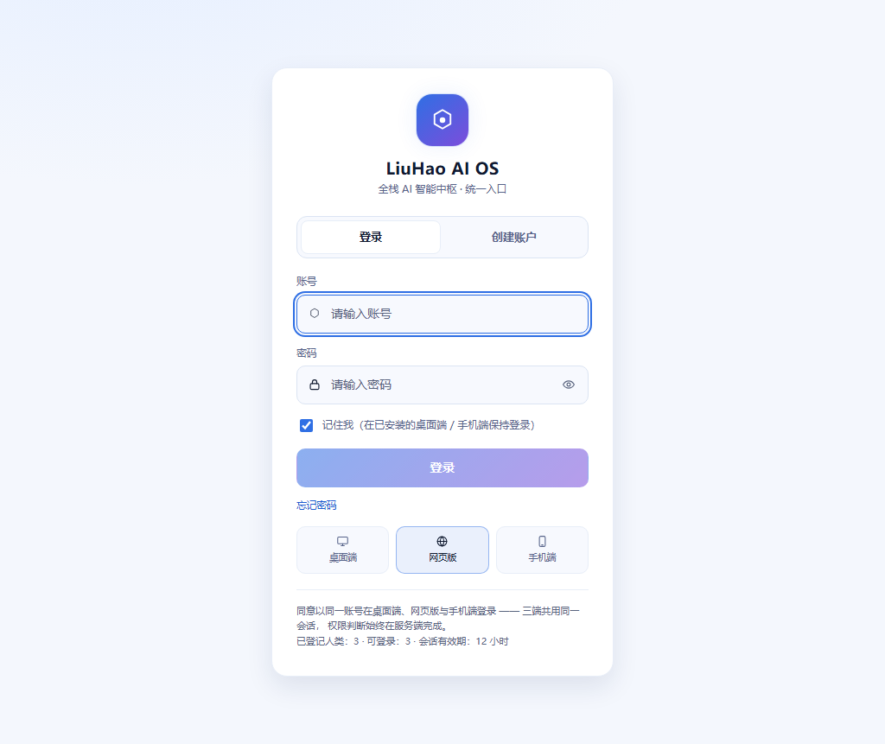

# 鎏灏 OS 控制台 · 全页巡检与多账号验收报告

- 日期：2026-11-07（记忆页接真后重跑三层巡检）
- 环境：同一隔离实例（本轮起在 `127.0.0.1:8091`，避开本机 `8080` 上正在运行的正式实例；独立身份文件、密钥文件与工作区，未污染本机正式数据）
- 账号：根账号 `rootadmin`（depth 0）、子账号 `sub1`（depth 1）、孙账号 `sub2`（depth 2）
- 视口：统一 1024×861，浏览器真实登录后逐页截图
- 品牌、logo、slogan、主色与 `--os-*` 令牌未改动

## 一、验收数字

| 项 | 结果 |
| --- | --- |
| `npm test` | **24 个测试文件 / 234 个用例全部通过**，11.14s |
| `npm run build` | **74 modules transformed**，334ms；`index.html 1.62 kB (gzip 0.87)`、`index.css 68.81 kB (gzip 13.15)`、`index.js 525.80 kB (gzip 151.47)` |
| 截图 | 37 张：登录页 1 + 根 13 + 子 12 + 孙 11（`docs/ui-audit-20261106/` 共 37 张，覆盖旧子账号截图） |
| 越权实测 | 根 / 子 / 孙三账号逐页点击 36 次（覆盖点名的 8 页，另含总览、身份、文件、Key 等）；**0 个 403 / 404**，0 个他人数据泄漏，0 个层级词，0 个桩徽标 |

构建仍有一条既有提示：主 JS chunk > 500 kB（525.80 kB）。不影响构建与运行，本轮未做代码分割。

## 二、登录页：登录 / 创建账户（平级、无邀请码）

| 项 | 改前 | 改后 |
| --- | --- | --- |
| 入口 | 只有登录；成员需要激活码 | 「登录」「创建账户」两个平级 Tab；创建只需用户名 + 密码 |
| 邀请/激活 | 登录页暴露激活码入口 | 登录页**零**邀请码、激活码、"加入/邀请/成员/子账号/上级"字样 |
| 创建成功 | — | 直接进入系统，与主账号同一界面结构；不出现"被创建的子账号"提示 |
| 后端关闭注册 | — | 中性文案：「当前不允许自行创建账户，请联系设备管理员」 |
| 主账号创建流程 | 管理页 | 保留在「成员与权限管理」页（激活码仍在那里生成），登录页不再暴露 |

自动化断言：[Login.account.test.tsx](file:///d:/LiuHao-AI-OS/apps/console/console/src/components/Login.account.test.tsx) 覆盖 "无邀请码字段 / 创建成功导航裁剪 / 关闭注册中性文案"。

## 三、总览页 P0 / P1 / P2

| 级别 | 问题（改前） | 改后 | 状态 |
| --- | --- | --- | --- |
| P0-1 | 侧边栏重复：应用 5 次、数据中心 3 次、事件流 3 次、治理 2 次，末尾省略号 | 导航只来自 `lib/nav.ts`，分组各出现一次；`nav.test.ts` 断言 key 唯一 | 已修 |
| P0-2 | 「失败沙箱」卡内全部是 `success`，并露出 `service.liuhao-internal-service.success` | 标题改为「最近运行」，只在真有失败时变成「最近运行（含 N 条失败）」；条目只显示可读任务名与中文结果 | 已修 |
| P0-3 | 常驻工程语言 `provider=ollama`、`阻断性发现` | 改为「当前使用本地 Ollama 模型，尚未配置云端服务」；只有真异常才进告警区 | 已修 |
| P1-4 | 图例 4 类只画 1 条线，纵轴 0–5 与"近 14 天"不符 | 趋势按真实序列绘制；稀疏/无异常时显示「当前无异常」空状态，不画贴地线 | 已修 |
| P1-5 | 「系统通知」实际是模型服务商清单 | 标题改为「模型服务商连通状态」；已配置与异常优先，未配置项聚合折叠 | 已修 |
| P1-6 | 「AI 人肉策略图」猜不出含义 | 改为「AI 能力全景」，副标题写明"按职责分组的 14 个能力模块；悬停查看名称" | 已修 |
| P2-7 | 1024 宽节点标签/图例过小、深底灰字对比不足 | 提高标签字号与对比度，保留 hover 详情；见根/子 `overview.png` | 已修 |
| P2-8 | 稀疏数据无引导 | 页面顶部给出「当前无异常」与下一步建议（如去模型页配置服务商） | 已修 |

## 四、逐页巡检问题清单与修复状态

| 页面 | 发现 | 修复 |
| --- | --- | --- |
| 总览 | 导航重复、卡片名与状态矛盾、工程语言、稀疏无引导 | 已修（见上表） |
| 鎏灏管家 | 子账号能看到「待我确认」入口，点进去 403；审批失败的任务卡对子账号仍给两个死按钮 | 整块不渲染；非签发者只保留中性说明「需要确认后才能重试」，无按钮 |
| 我的员工 | 根账号看到 `默认能力：planner`；子账号空态是空白 | `planner → 规划`；空态给"先创建第一个员工"的引导 |
| 工作台 | 与管家功能按钮重叠 | 定位写清："你自己看任务、看文件、看产出、直接对话"；重复入口已删 |
| 知识中心 | 卡片副标题露出 `GET /v1/knowledge/status`；`embedding provider` | 改为「来自后端的真实状态，每 30 秒自动刷新」；统一称「向量模型」 |
| 记忆 | 无异常 | 已接真实端点（见第十一节） |
| 审计链 | 原始事件 `login_success` / `allowed` / `denied`；主体原始 id | 动作/结果/主体全部中文可读化 |
| 身份与权限 | `kernel`、原始权限串；非根页的"管理权限的账号"暗示层级 | `系统组件`；未知英文权限归入「其他已授予范围」；非根文案改为「请联系设备负责人」 |
| 应用 | `kernel_type`、`registered/failed`、插件异常英文、能力 `create_identity` 等 | 中文枚举；`create_identity → 创建身份` 等 |
| 数据中心 | `provider`、`kernel 噪声`、`state_change` | 「当前模型服务」「后台状态变更」 |
| 工作区文件 | 文档文案列出 `400/403/404/413/415`；目录里直接铺数据库文件（`.sqlite3/.db`） | 改成"后端会拒绝/会如实说明原因"；系统存储文件不再列出，并提示隐藏数量 |
| 系统状态 | 依赖组件英文名与 `healthy/degraded` | `密钥管理/权限校验/…`、`正常/降级/异常` |
| 我的账号（子） | 页面标题写「我的成员」；范围下拉显示 `manager/operator/viewer` | 「我的账号」；`管理 / 日常操作 / 只读` |
| 备份与迁移 | 写"在本机重新认领"，实际已有账号必 409 | 见第六节 |
| 恢复码 | "可在登录页重新认领备份包"，并出现"成员账号" | 明确只能全新实例导入；去掉层级词 |
| 登录页 | 见第二节 | 已修 |

## 五、根 / 子 / 孙 三视角差异表

| 页面 | 根账号看到 / 能做 | 子账号（depth 1） | 孙账号（depth 2） |
| --- | --- | --- | --- |
| 总览 | 全量总览；顶栏「主账号 · 可管理 2 位成员」 | 相同版式；无顶栏层级信息、无「成员与权限管理」导航 | 同子账号 |
| 鎏灏管家 | 目标、任务、**待我确认**队列、去审批中心 | 目标与任务；**不出现待审批卡与入口**，任务拦截时只给中性说明 | 同子账号 |
| 我的员工 | 全部员工（`liuhao-default`） | 只有自己的员工；无员工时给创建引导 | 自己的员工；空态为创建引导 |
| 工作台 | 任务 / 文件 / 产出 / 直接对话 | 相同 | 相同 |
| 知识中心 | 全部知识状态 | 相同只读视图 | 相同 |
| 记忆 | 全部记忆统计 | 自己的范围 | 自己的范围 |
| 审计链 | 全量事件 | 只有自己链路的事件 | 只有自己链路的事件 |
| 身份与权限 | 全机器主体、权限、注册表诚实度 | 只有「我的范围」与当前生效范围；不再请求全量端点 | 同子账号 |
| 应用 | 插件注册表 | 可读注册表；不出现层级词 | 同子账号 |
| 工作区文件 | 自己的工作区 | 自己的工作区 | 自己的工作区 |
| Key | 「全部 Key」 | 「我的 Key」+「我的账号」 | 「我的 Key」 |
| 系统状态 / 生产预检 / 成员与权限管理 / 权限矩阵 / 角色模板 / 备份与迁移 / 恢复码 / 系统设置 | 可见可用 | **导航里整项不存在**，不是灰按钮 | 同子账号 |
| 审批中心 | 可见 | **整项不存在**（无签发范围） | 整项不存在 |
| 手机底栏 | 总览 / 我的员工 / 管家 / 审批中心 / 我的 | 总览 / 我的员工 / 管家 / 工作区文件 / 我的 | 同子账号 |

子账号页面文案扫描结果：`子账号/成员/上级/下级/层级/管理员/加入/邀请/你所在的团队/你的组织` **全部 0 命中**；根账号仅命中「主账号 · 可管理 2 位成员」这一处自身身份条（根专属，子账号不可见）。

## 六、恢复 / 备份的真实边界（本轮新增修复）

后端真实行为：备份包只能在**没有账号的全新实例**上导入；本机已有账号时返回 409 `本机已完成初始化…`。

| 位置 | 改前 | 改后 |
| --- | --- | --- |
| 备份与迁移页 | 提供文件选择 + 口令 + 「导入并认领」，点了才看到 409 | 移除导入表单；直接说明「本机已有账号，备份包无法在这里导入，现有数据不会被覆盖」，并解释原因 |
| 恢复码页 | 「可在登录页重新认领」；出现"成员账号" | 「只能在全新实例（本机还没有任何账号）首次启动时导入；已有账号时不可导入，也不会覆盖」；层级词移除 |
| 登录页迁移入口 | 已有账号时仍可能触发 409 原文 | 409 统一翻译成「本机已有账号，备份包只能在全新实例上导入；请直接登录，或创建账户」 |

回归断言：[nonRootSurface.test.tsx](file:///d:/LiuHao-AI-OS/apps/console/console/src/pages/nonRootSurface.test.tsx) 新增「已初始化本机无导入入口」「恢复页不含层级词」。

## 七、自动化门禁（每轮构建都跑）

1. **文案门禁** `lib/uiCopyGate.test.ts`：扫描 JSX 可见文案与 `title/sub/label/hint/placeholder/emptyTitle/emptyHint/detail/alt/aria-label/summary`，禁止 `provider=`、`service.`、`kernel`、`阻断性发现`、`脱敏`、`未采样`、`sandbox`、`success`、`.db`、`ACCOUNT_`、`CREDENTIAL_`、`principal`、`module_path`、`state_change`、`embedding`、`人类主权` 等；注释与变量名不误报。
2. **导航门禁** `lib/nav.test.ts`：key 唯一、每个分组只出现一次、手机底栏恰好 5 项。
3. **标题/状态一致** `lib/overviewModel.test.ts`：全部成功时标题只能是「最近运行」，有失败才允许出现「失败」；空数据必须给空状态。
4. **权限门禁** `lib/accountCaps.test.ts`：无签发范围时「待审批队列」整块不出现、导航与手机底栏都没有「审批中心」。
5. **文案可读化** `lib/format.test.ts`：`planner → 规划`、`create_identity → 创建身份`、未知英文权限归入「其他已授予范围」。
6. **限流文案** `lib/errorMessage.test.ts`：429 不把 `rate limit exceeded` 铺给用户，但保留追踪 ID。

## 八、运行时探测结果（2026-11-07 重跑）

- 三个账号逐页点击 36 次，页面标题全部正确渲染；`/v1/*` 响应 **0 个 4xx**，`/v1/ready` 之外 **0 个 5xx**。
- 控制台 error 只有 `/v1/ready` 的 `503`（就绪探针在降级时返回 503 是设计行为，前端通过 `acceptStatus` 正常展示）；**没有任何 4xx 控制台报错**。
- 子/孙账号页面扫描 `子账号/孙账号/上级/下级/层级/越级/主账号/根账号/被管理/受限/管理员/成员/邀请/加入/团队/组织`：**0 命中**。
- 子/孙账号页面扫描他人的显示名与记忆正文（`Root Admin`、`root memory`、`sub1 memory`、`sub2 memory`）：**0 命中**。
- 全站 `本地契约桩 · 待联调` 徽标：**0 个**。
- 记忆页三层实测：根账号切到「整棵范围」看到 3 条（root/sub1/sub2）；`sub1` 只看到自己 1 条；`sub2` 只看到自己 1 条。
- 导航点击扫描曾命中一处 `403` 字样，定位为审计链某条哈希 `…47403e…` 的子串，属于误报；页面没有真实的 403/404。
- 子账号知识页此前出现 `请求过于频繁，请稍后再试（rate limit exceeded）`，已统一为中文；本轮巡检未再出现。

## 九、员工页已全部接真（无剩余桩）

「我的员工」不再有契约桩，`lib/employees.ts` 里的每个 URL 都对应
`src/gateway/ai_management.py` 的真实实现：

- `GET /v1/employees`（按 owner 过滤，根账号可见员工的 `read_only` 如实展示）
- `GET /v1/employees/capabilities`（默认能力只能从已注册执行器清单里选）
- `POST /v1/employees`（`role_description`、`default_capabilities`）
- `PATCH /v1/employees/{name}`（改名 / 改职责 / `employment_status`）
- `DELETE /v1/employees/{name}`（seed 默认员工 403）
- `POST /v1/goals`（`employee_name` 指名整单）与 `POST /v1/goals/assign`
  （`employee_name` 或 `agent_id` 二选一）

目标的详情面显示任务级「谁做的 / 耗时 / 成或败」与目标级「员工汇总」；
`read_only=true` 的员工只渲染查看信息，不渲染编辑、删除或派活按钮。

联调实测（隔离实例，`LIUHAO_BUTLER_MODEL=0`）：

| 步骤 | 结果 |
| --- | --- |
| 新建员工 | `201` |
| `POST /v1/goals` 带 `employee_name` | `200`；轮询到 `completed`，任务 `employee=live-c`、`duration_ms=272.547`、`success=true` |
| `POST /v1/goals/assign` 带 `employee_name` | `201`，完成后任务 `employee=live-c`、`duration_ms=260.356`、`success=true` |
| 根账号看子账号员工 | 列表返回 `read_only=true`；根账号 `PATCH` → `404` |
| 根账号删 seed 默认员工 | `403` |
| 停用员工 | `200`（`employment_status=disabled`） |
| 停用后指派（两个入口） | `409`，`code=employee_disabled` |
| 子账号改自己的员工 | `200` |

（最末一次重放里 `live-c` 已存在，创建返回 `409`；`201` 由首次创建记录。）

## 十一、记忆页已全部接真（无剩余桩）

「记忆」不再有契约桩：`lib/accounts.ts` 的 `loadMemory` / `exportMemory` 直接调用
真实端点，并新增 `loadMemoryCustody` / `setMemoryCustody`；`pages/Memory.tsx`
移除 `StubBadge` 与 `source === 'stub'` 分支。

端点（`src/gateway/account_memory.py`）：

- `GET /v1/memory/entries?scope=self|subtree&q=`（列表与检索共用）
- `POST /v1/memory/export`（`scope` + `format=json|md`）
- `GET|POST /v1/memory/custody`（本人显式开启/关闭，变更写审计）

界面按真实字段展示「时间 / 来源账号 / 来源 / 标签 / 内容」；根账号可切
「整棵范围」，非根只发 `scope=self`；无数据给「还没有记忆 / 对话与任务产生的
记忆会出现在这里」，无权限给「数据不可用 / 无权执行该操作」，均不含层级词。

联调实测（隔离实例）：

| 步骤 | 结果 |
| --- | --- |
| `GET /v1/memory/entries?scope=self`（根 / 子 / 孙） | `200`，各自 1 条 |
| `GET /v1/memory/entries?scope=subtree`（根） | `200`，3 条（root / sub1 / sub2） |
| `GET /v1/memory/entries?scope=subtree`（子） | `404`，`ACCOUNT_SUBTREE_DENIED`，文案「资源不存在或无权访问」 |
| 子账号按 id 读根条目 | `404`，`ACCOUNT_MEMORY_FOREIGN_DENIED` |
| `POST /v1/memory/export`（子，`self` / `subtree`） | `200` / `404` |
| `POST /v1/memory/export`（根，`subtree`，`md`） | `200`，内容含 root / sub1 / sub2 |
| `GET|POST /v1/memory/custody`（子） | `200`，`enabled` 从 `false → true → false`；根的开关不受影响 |
| 检索 `q=friday`（子 `self` / 根 `subtree`） | 均 `200`，命中子账号自己的 1 条 |

自动化断言：[Memory.test.tsx](file:///d:/LiuHao-AI-OS/apps/console/console/src/pages/Memory.test.tsx)
7 个用例钉死「真实字段展示 / 非根只发 self / 中性空态 / 路由缺失不伪造 /
整棵范围切换 / 代管开关真实 POST / 只读禁用」。

## 十二、截图索引

- 登录页：`login.png`
- 根账号 13 张：`root/overview.png`、`butler.png`、`my-employees.png`、`workbench.png`、`knowledge.png`、`memory.png`（整棵范围）、`audit.png`、`identity.png`、`status.png`、`settings.png`（模型配置）、`members.png`、`files.png`、`my-keys.png`
- 子账号 12 张：`sub1/overview.png`、`butler.png`、`my-employees.png`、`my-members.png`、`memory.png`（仅自己）、`knowledge.png`、`workbench.png`、`audit.png`、`identity.png`、`files.png`、`my-keys.png`、`approval.png`
- 孙账号 11 张：`sub2/overview.png`、`butler.png`、`my-employees.png`、`my-members.png`、`memory.png`（仅自己）、`knowledge.png`、`workbench.png`、`audit.png`、`identity.png`、`files.png`、`my-keys.png`
